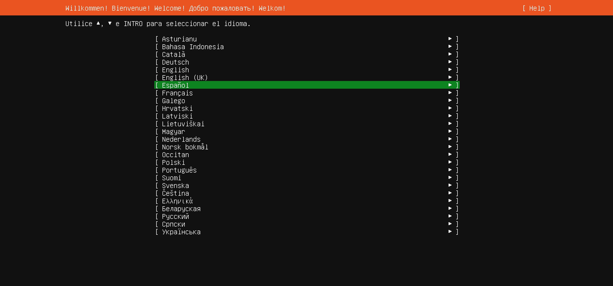

# Paso 1: Idioma

> Paso 1 de 13 · [← Antes de empezar](README.md) · Siguiente: [Teclado](02-teclado.md)

Es la primera pantalla del instalador, en cuanto la VM arranca desde el ISO. Se mueve con
las flechas ▲ ▼ y se confirma con **Enter**.

**Qué elegir:** `Español`.

El idioma que elijas aquí se usa para el instalador **y** queda como idioma del sistema
instalado: los mensajes de la terminal y de los comandos saldrán en español.

## Español o inglés: una decisión de administrador

En servidores reales muchos administradores instalan en inglés aunque hablen español. No
es por gusto: los mensajes de error se buscan en Internet tal cual aparecen, y casi toda la
documentación y los foros están en inglés. Un error en inglés da muchos más resultados.

Para este curso cualquiera de los dos es válido. Lo importante es que sea una decisión
consciente — es el primer ejemplo de **administración de configuración** (la C de FCAPS,
[Etapa 1](../../etapa-1-funciones-administracion/01-administracion-configuracion.md)):
en un equipo de varios servidores, todos deberían instalarse con el mismo idioma para que
los registros (logs) se lean igual en todos.

> **Nota:** si aparece una pantalla de "actualización del instalador disponible", elige
> continuar sin actualizar. Solo sale cuando hay una versión más nueva del instalador
> que la que trae el ISO.
