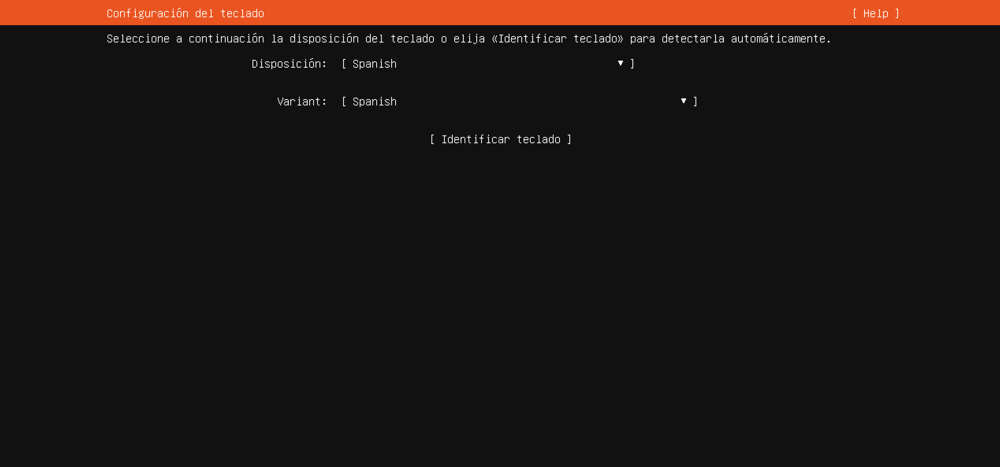

# Paso 2: Teclado

> Paso 2 de 14 · [← Idioma](01-idioma.md) · Siguiente: [Tipo de instalación](03-tipo-de-instalacion.md)



Aquí le dices a Ubuntu **qué símbolo corresponde a cada tecla física**. Si no coincide con
tu teclado real, al escribir `@`, `|`, `/` o `ñ` aparecerán otros caracteres — y
como en un servidor todo se escribe en la terminal, esto importa mucho más que en una
computadora con mouse.

El instalador propone `Spanish`, que es la distribución de **España**. Casi todas las
laptops vendidas en México traen distribución **latinoamericana**, así que hay que
cambiarlo:

| Campo | Valor |
|---|---|
| Disposición (*Layout*) | `Spanish (Latin American)` |
| Variante (*Variant*) | `Spanish (Latin American)` |

Para abrir cada lista: Tab hasta el campo, **Enter**, flechas, **Enter**. Al final, Tab
hasta **[ Hecho ]**.

## Cómo saber cuál es tu teclado

Mira la tecla a la derecha de la `L`: si es `Ñ` y junto a ella está `{` con `[`,
es latinoamericano. Si al lado de la `Ñ` aparece `´` (acento) con `¨`, es de España.
En Windows también puedes verlo en **Configuración → Hora e idioma → Idioma y región**.

## Si después algún símbolo sale cambiado

No hace falta reinstalar. Ya dentro del sistema, el teclado se vuelve a configurar con:

```bash
sudo dpkg-reconfigure keyboard-configuration
```

Prueba sobre todo `|` (barra vertical): es el carácter de las tuberías (*pipes*) que
viste en la [Terminal](../../00-fundamentos-computo/08-terminal.md), y lo vas a usar
constantemente.
