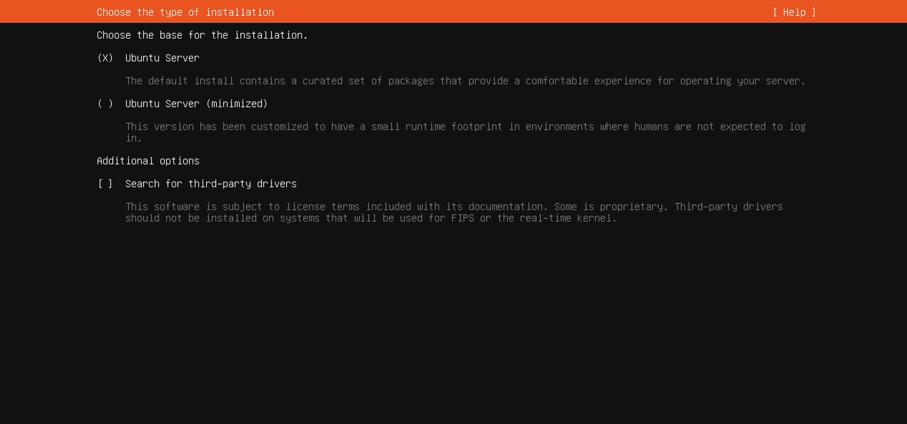

# Paso 3: Tipo de instalación

> Paso 3 de 13 · [← Teclado](02-teclado.md) · Siguiente: [Red](04-red.md)

Aquí decides **qué tan completo** queda el sistema base:

| Opción | Qué es | ¿La usamos? |
|---|---|---|
| **(X) Ubuntu Server** | Instalación normal: incluye las herramientas de uso diario (editor `nano`, manuales `man`, utilidades de red) | **Sí** — ya viene marcada |
| ( ) Ubuntu Server (minimized) | Versión recortada para servidores donde "no se espera que una persona inicie sesión": contenedores, nubes automatizadas | No: aquí sí vamos a entrar a escribir comandos |
| [ ] Search for third-party drivers | Busca controladores privativos (por ejemplo, de tarjetas de video) | **Desmarcado**: la VM solo tiene hardware virtual |

Déjala como viene y baja con Tab hasta **[ Done ]**.

## Por qué existe la versión mínima

Cada programa instalado es algo más que actualizar y una posible puerta de entrada más
para un atacante. Por eso, en servidores que nadie usa a mano, se instala **lo mínimo
indispensable**: menos programas, menos **superficie de ataque**. Es la misma idea de
"pocos servicios por servidor" de [Servidores](../../etapa-2-servicios-red/01-servidores.md),
y parte de la [administración de seguridad](../../etapa-1-funciones-administracion/05-administracion-seguridad.md).
En nuestro caso la versión completa se justifica porque es un servidor de aprendizaje.
