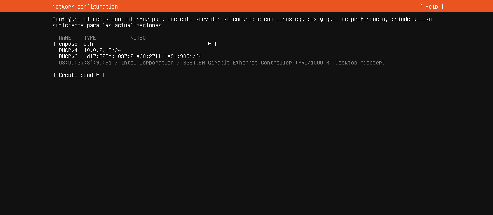

# Paso 4: Red

> Paso 4 de 13 · [← Tipo de instalación](03-tipo-de-instalacion.md) · Siguiente: [Proxy](05-proxy.md)



El instalador muestra las tarjetas de red que encontró y la dirección que obtuvo cada
una. **No cambies nada**: baja con Tab hasta **[ Done ]**. Pero vale la pena leerla,
porque reúne en una sola pantalla casi todo lo que viste en Redes y Telecomunicaciones.

| Lo que aparece | Qué es |
|---|---|
| `enp0s8` | Nombre de la tarjeta en Linux. `en` = Ethernet, `p0s8` = su ubicación en el bus PCI. En Windows sería "Ethernet" |
| `eth` | Tipo de interfaz: Ethernet (cable) |
| `DHCPv4 10.0.2.15/24` | IPv4 asignada **automáticamente por DHCP**. `/24` es la máscara 255.255.255.0 |
| `DHCPv6 fd17:...` | Dirección IPv6, también automática |
| `08:00:27:...` | La **dirección MAC**. `08:00:27` es el prefijo que usan las tarjetas virtuales de VirtualBox |
| `Intel 82540EM...` | Modelo de tarjeta que VirtualBox simula |
| `[ Create bond ]` | Unir varias tarjetas en una sola (redundancia). No lo necesitamos |

## Por qué la IP es 10.0.2.15

Esa dirección es la que VirtualBox entrega en modo **NAT**: la VM queda "detrás" de tu
computadora, como una casa dentro del fraccionamiento que sale a Internet por la caseta,
pero a la que nadie de afuera puede llegar directamente.

```
Internet ── Router (casa/lab) ── Tu computadora ── NAT de VirtualBox ── VM
                                  (192.168.x.x)                      (10.0.2.15)
```

Para instalar es justo lo que queremos: la VM tiene Internet para descargar
actualizaciones. Cuando más adelante otros equipos necesiten conectarse a este servidor
(por SSH, o a los servicios de la Etapa 2), se apaga la VM y se cambia el adaptador a
**puente**, sin reinstalar: con puente, la VM pide su propia IP al DHCP de la red real.

El servicio que entregó esa IP es exactamente el que estudiaste en
[DHCP](../../etapa-2-servicios-red/02-dhcp.md) — aquí el servidor DHCP es el propio
VirtualBox.
