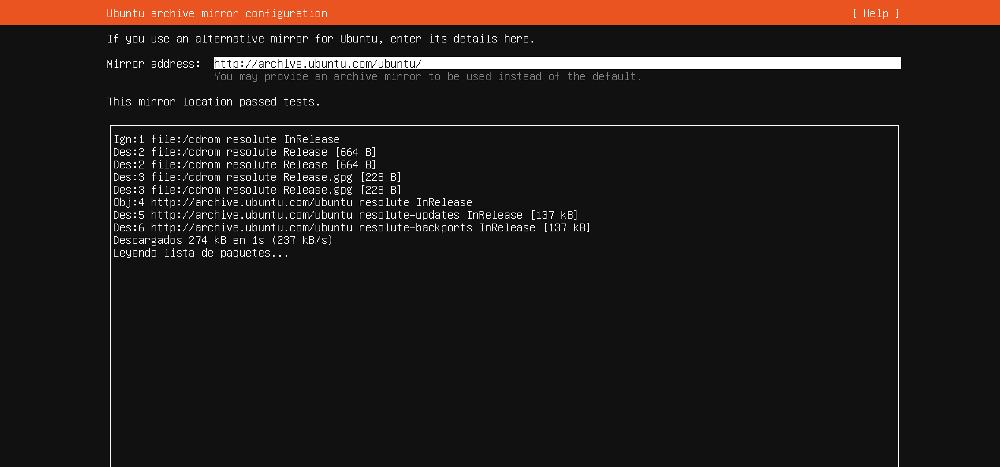

# Paso 6: Mirror (réplica de paquetes)

> Paso 6 de 14 · [← Proxy](05-proxy.md) · Siguiente: [Almacenamiento](07-almacenamiento.md)

Un **mirror** (réplica) es un servidor que guarda una copia de todos los paquetes de
Ubuntu. De ahí descarga el sistema cada programa que instales después con `apt` (el
gestor de paquetes que viste en la [Terminal](../../00-fundamentos-computo/08-terminal.md)).

**Qué hacer:** dejar la dirección propuesta, `http://archive.ubuntu.com/ubuntu/`, y
elegir **[ Done ]**.

## Cómo leer esta pantalla

- **"This mirror location passed tests"**: el instalador ya probó la réplica y respondió.
- El recuadro de abajo es la prueba en vivo: las líneas `Des:` (descargado) con tamaños
  en kB confirman que **la VM sí tiene Internet** a través del NAT del paso anterior.
- `resolute` es el **nombre en clave** de Ubuntu 26.04 (*Resolute Raccoon*). Cada
  versión de Ubuntu tiene uno, y aparece en las rutas de los paquetes.

Una empresa con cientos de servidores suele tener **su propia réplica interna**: así no
salen todos a Internet a descargar los mismos paquetes, y se ahorra ancho de banda. Es el
caso en que este campo sí se cambiaría.
