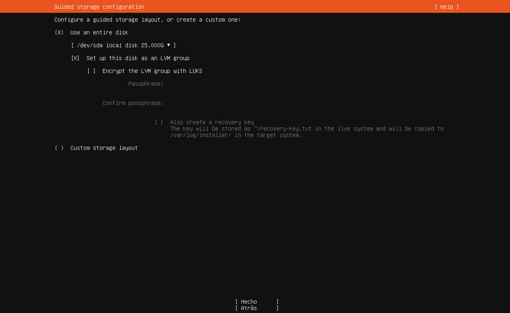

# Paso 7: Almacenamiento

> Paso 7 de 14 · [← Mirror](06-mirror.md) · Siguiente: [Resumen de particiones](08-resumen-particiones.md)



Aquí decides cómo se usa el disco. Recuerda que es el **disco virtual de 25 GB** que
creaste en VirtualBox: un archivo `.vdi` dentro de tu computadora. Nada de lo que elijas
aquí toca tu disco real.

| Opción | Qué elegir |
|---|---|
| **(X) Use an entire disk** | **Sí**: usar todo el disco virtual |
| `/dev/sda local disk 25.000G` | El disco de la VM. Linux nombra los discos `sda`, `sdb`... (`sd` = disco, `a` = el primero). En Windows sería "Disco 0" |
| **[X] Set up this disk as an LVM group** | **Marcado** (viene así) |
| [ ] Encrypt the LVM group with LUKS | **Desmarcado** |
| ( ) Custom storage layout | No: es para particionar a mano |

Baja con Tab hasta **[ Hecho ]**.

## LVM: particiones que se pueden estirar

Con particiones tradicionales, el tamaño se fija al instalar y cambiarlo después es
delicado. **LVM** (*Logical Volume Manager*) agrega una capa intermedia: los discos se
juntan en un **grupo de volúmenes** (una bolsa de espacio), y de esa bolsa se sacan
**volúmenes lógicos** del tamaño que se necesite, que después se pueden agrandar sin
reinstalar (Red Hat, s.f.).

```
Disco físico (/dev/sda)
        │
        v
Grupo de volúmenes (ubuntu-vg)       <-- "bolsa" de espacio
        │
        ├── Volumen lógico (ubuntu-lv) --> /   (el sistema)
        └── Espacio libre                     (para crecer después)
```

## LUKS: cifrar el disco

**LUKS** cifra todo el disco: sin la contraseña, los datos son ilegibles aunque alguien
se lleve el disco físico. El costo es que pide esa contraseña **cada vez que el equipo
arranca**, lo que en un servidor de clase solo estorba.

Es una decisión de **seguridad** (la S de FCAPS) típica de laptops y de servidores con
datos sensibles. En el [Paso 14](14-primer-inicio.md) verás por qué importa: sin
cifrado, quien tenga acceso a la consola puede restablecer la contraseña de un usuario.

## Referencias

Red Hat. (s.f.). *Configuring and managing logical volumes* [Red Hat Enterprise Linux 9
documentation].
https://docs.redhat.com/en/documentation/red_hat_enterprise_linux/9/html/configuring_and_managing_logical_volumes/index
