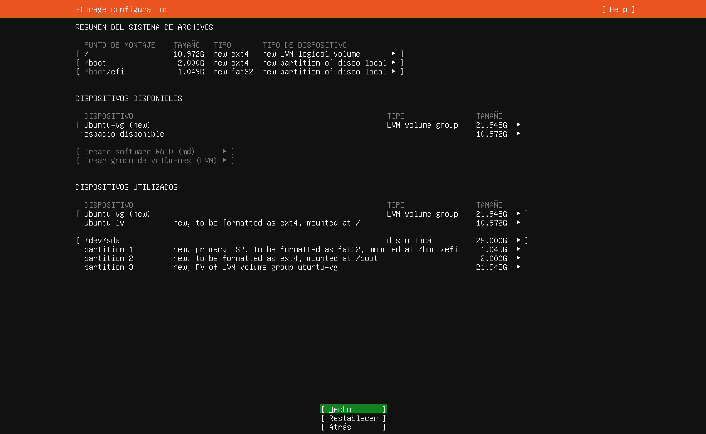
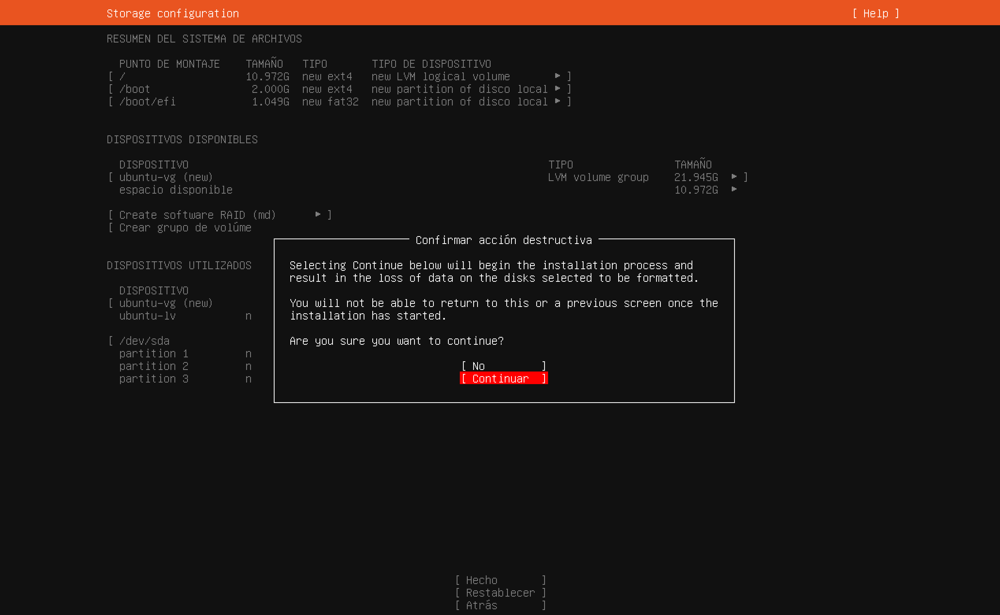

# Paso 8: Resumen de particiones y confirmación

> Paso 8 de 13 · [← Almacenamiento](07-almacenamiento.md) · Siguiente: [Perfil](09-perfil.md)



Antes de escribir nada en el disco, el instalador muestra **cómo va a quedar**. Nada se
ha borrado todavía: si algo no te convence, **[ Atrás ]** regresa al paso anterior.

## Cómo queda repartido el disco de 25 GB

```
/dev/sda (25 GB, disco virtual)
├── partición 1    1 GB  fat32  --> /boot/efi   arranque UEFI
├── partición 2    2 GB  ext4   --> /boot       kernel de Linux
└── partición 3   22 GB         --> grupo LVM "ubuntu-vg"
                                    ├── ubuntu-lv  11 GB  ext4 --> /
                                    └── libre      11 GB  (para crecer después)
```

| Término | Qué es |
|---|---|
| **Punto de montaje** | La carpeta donde "aparece" una partición. En Linux no hay `C:` ni `D:`: todo cuelga de `/`, la **raíz** |
| `/boot/efi` | La **partición de sistema EFI** (ESP): lo primero que lee el firmware UEFI al encender. La especificación UEFI exige que use un sistema de archivos FAT, por eso es `fat32` (UEFI Forum, 2022) |
| `/boot` | El kernel de Linux y lo necesario para arrancarlo (Linux Foundation, 2015) |
| `/` | Todo lo demás: programas, configuración, carpetas de usuarios |
| `ext4` | El sistema de archivos estándar de Linux. Su equivalente en Windows sería NTFS |

## ¿Por qué solo 11 GB para `/`?

El instalador asigna a `/` solo una parte del grupo LVM y deja el resto **libre a
propósito**: así hay espacio para agrandar `/` después, o para crear otro volumen (por
ejemplo, uno exclusivo para datos), sin reinstalar. Para este curso 11 GB sobran.

Elige **[ Hecho ]**.

## Confirmar la acción destructiva



El aviso dice que, al continuar, **se borran los datos** de los discos seleccionados y
**ya no se podrá regresar** a las pantallas anteriores: la instalación empieza en ese
momento, en segundo plano, mientras llenas los pasos que faltan.

Aquí es un disco virtual vacío, así que elige **[ Continuar ]**. En un servidor real,
esta es la pantalla donde se confirma dos veces que se eligió el disco correcto.

## Referencias

Linux Foundation. (2015). *Filesystem Hierarchy Standard* (versión 3.0).
https://refspecs.linuxfoundation.org/FHS_3.0/fhs-3.0.html

UEFI Forum. (2022). *Unified Extensible Firmware Interface (UEFI) specification*
(versión 2.10). https://uefi.org/specifications
