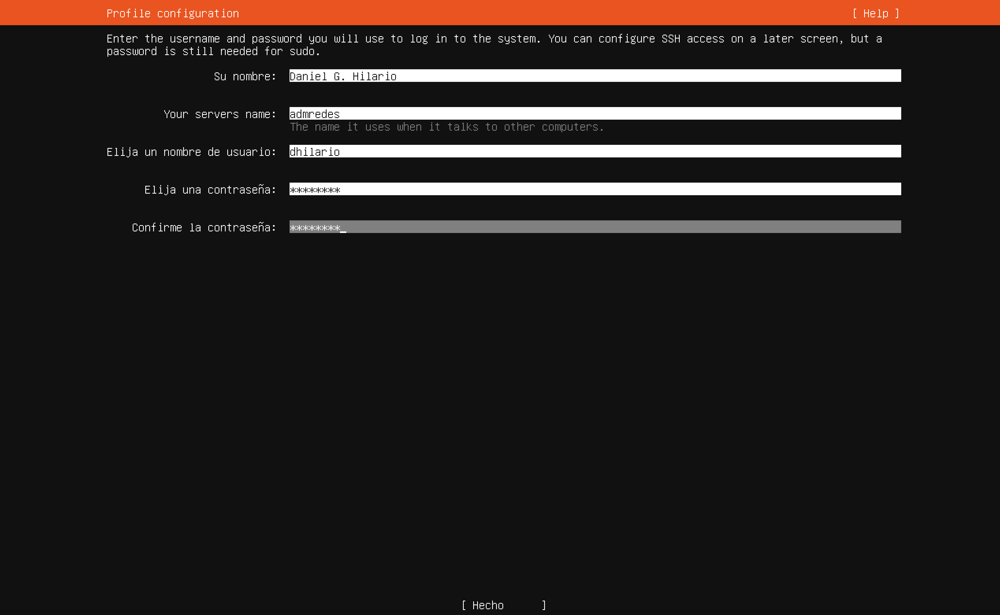

# Paso 9: Perfil — usuario y nombre del servidor

> Paso 9 de 13 · [← Resumen de particiones](08-resumen-particiones.md) · Siguiente: [Ubuntu Pro](10-ubuntu-pro.md)



| Campo | Qué es | Ejemplo |
|---|---|---|
| **Su nombre** | Nombre para mostrar. Solo es informativo | `Daniel G. Hilario` |
| **Your server's name** | El **hostname**: el nombre del equipo en la red | `admredes` |
| **Nombre de usuario** | La cuenta para iniciar sesión. Minúsculas, sin espacios ni acentos | `dhilario` |
| **Contraseña** | La de esa cuenta. Se muestra con asteriscos | — |

Recorre los campos con Tab y al final elige **[ Hecho ]**.

## El hostname

El nombre del servidor aparece en el **prompt** de la terminal, junto al usuario:

```
dhilario@admredes:~$
└──┬───┘ └──┬───┘ │
 usuario  servidor carpeta actual (~ = tu carpeta personal)
```

Cuando administras varios servidores a la vez por SSH, el prompt es lo que te dice **en
cuál estás**. Por eso conviene un nombre corto y descriptivo (`web01`, `dns-lab`,
`admredes`), nunca uno genérico como `server` o `ubuntu`. Elegir y documentar esos
nombres es otra vez **administración de configuración**.

## La primera cuenta es administradora

El usuario que creas aquí puede usar `sudo` (ejecutar comandos como administrador, lo
viste en la [Terminal](../../00-fundamentos-computo/08-terminal.md)). Por eso:

- **Usa una contraseña exclusiva para este servidor**, que no sea la de tu correo ni la
  de ninguna otra cuenta.
- **No compartas esta cuenta.** Si otras personas van a entrar al servidor, se les crea
  una cuenta propia después de instalar (`sudo adduser nombre`), sin permisos de
  administrador. Así cada acción queda registrada a nombre de quien la hizo — es la
  **contabilidad** (la A de FCAPS) de la
  [Etapa 1](../../etapa-1-funciones-administracion/04-administracion-contabilidad.md).
