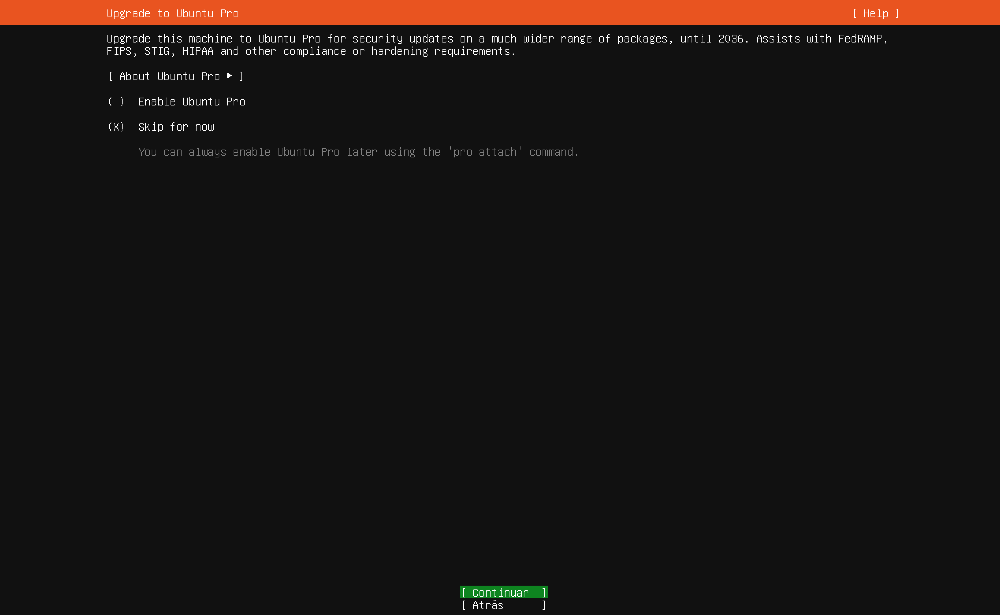

# Paso 10: Ubuntu Pro

> Paso 10 de 14 · [← Perfil](09-perfil.md) · Siguiente: [SSH](11-ssh.md)



**Qué hacer:** dejar marcado **(X) Skip for now** y elegir **[ Continuar ]**.

## Qué es Ubuntu Pro

Cada versión **LTS** de Ubuntu recibe **5 años** de actualizaciones de seguridad
estándar, gratis. **Ubuntu Pro** es una suscripción de Canonical que extiende esa
cobertura a **10 años** (ESM, *Expanded Security Maintenance*) y la amplía a más
paquetes. Para Ubuntu 26.04 eso significa soporte estándar hasta mayo de 2031, y con
Ubuntu Pro hasta mayo de 2036 — de ahí el "until 2036" que aparece en la pantalla
(Canonical, s.f.).

Para este curso los 5 años estándar son más que suficientes. Si algún día se necesita,
se activa sin reinstalar con el comando que menciona la propia pantalla:

```bash
sudo pro attach
```

## Por qué importa el ciclo de vida

Un sistema operativo **sin soporte** ya no recibe parches de seguridad: cualquier falla
que se descubra después queda abierta para siempre. Es exactamente lo que pasa con el
Windows Server 2003/2008 que describe el manual oficial, y por eso este curso instala un
sistema vigente. Saber hasta cuándo tiene soporte cada servidor es parte de la
**administración de seguridad** (la S de FCAPS).

## Referencias

Canonical Ltd. (s.f.). *Ubuntu release cycle*. https://ubuntu.com/about/release-cycle
