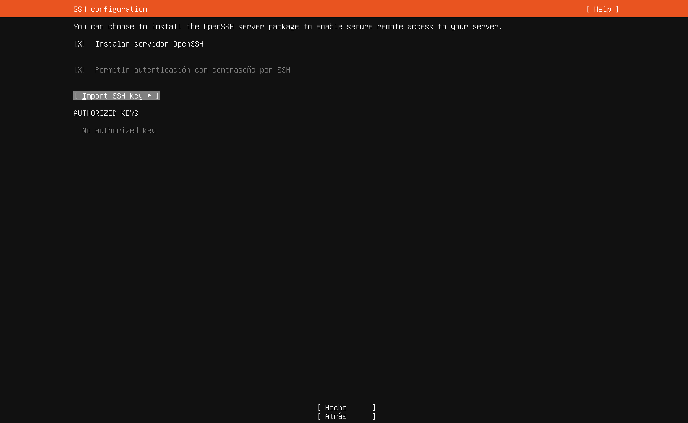

# Paso 11: SSH

> Paso 11 de 14 · [← Ubuntu Pro](10-ubuntu-pro.md) · Siguiente: [Snaps destacados](12-snaps.md)



Esta es la pantalla **más importante** para el resto del curso: sin SSH, la única forma
de usar el servidor sería sentarse frente a su consola.

| Opción | Qué elegir |
|---|---|
| **[X] Instalar servidor OpenSSH** | **Marcarlo** con la barra espaciadora |
| **[X] Permitir autenticación con contraseña por SSH** | **Marcado**. Se ve en gris porque depende de la opción de arriba, pero está activo |
| `[ Import SSH key ]` | No usarlo. "No authorized key" es lo esperado |

**Cuidado al salir:** el cursor queda sobre **[ Import SSH key ]**. Si presionas Enter
ahí, se abre el diálogo de importar llaves. Baja primero con **Tab** hasta
**[ Hecho ]**. Si se abrió por error, ciérralo con **[ Cancelar ]**.

## Qué es SSH

**SSH** (*Secure Shell*) es el protocolo para controlar un equipo remoto por terminal,
con todo el tráfico **cifrado**: usuario, contraseña y cada comando viajan protegidos. El
servidor escucha normalmente en el **puerto 22/TCP** (Ylonen & Lonvick, 2006).
**OpenSSH** es la implementación libre de SSH que usan Linux, macOS y Windows (OpenBSD
Project, s.f.).

```
Laptop del alumno                                 Servidor (VM)
┌─────────────────┐   conexión cifrada (TCP 22)  ┌──────────────────┐
│ ssh dhilario@IP │ ───────────────────────────> │ sshd (OpenSSH)   │
└─────────────────┘ <─────────────────────────── │ dhilario@admredes│
                       salida de los comandos     └──────────────────┘
```

Es el reemplazo seguro de **Telnet**, que hacía lo mismo pero en texto claro: cualquiera
que capturara el tráfico podía leer la contraseña.

## Contraseña o llaves

Las **llaves SSH** son más seguras que una contraseña: no se pueden adivinar por fuerza
bruta. La casilla "Import SSH key" sirve para traer una llave pública ya existente. Para
empezar usaremos contraseña — es lo más simple cuando varias personas se conectan por
primera vez — y las llaves se verán más adelante, como mejora de seguridad.

## Referencias

OpenBSD Project. (s.f.). *OpenSSH*. https://www.openssh.com/

Ylonen, T., & Lonvick, C. (Ed.). (2006). *The Secure Shell (SSH) transport layer
protocol* (RFC 4253). IETF. https://www.rfc-editor.org/rfc/rfc4253
