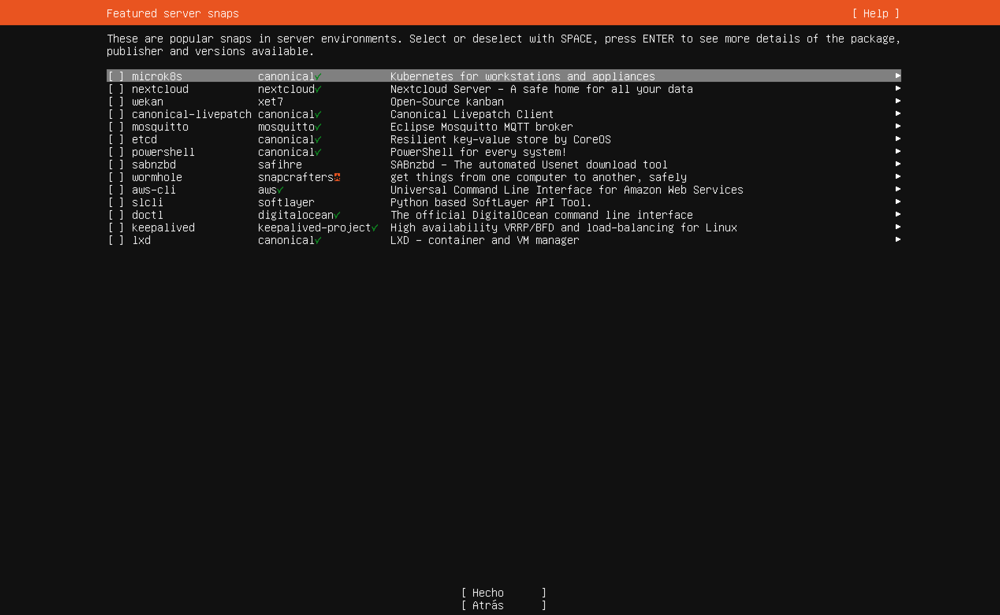

# Paso 12: Snaps destacados

> Paso 12 de 13 · [← SSH](11-ssh.md) · Siguiente: [Instalación y reinicio](13-instalacion.md)

**Qué hacer:** **no marcar nada** y elegir **[ Hecho ]**. Igual que en el paso anterior,
el cursor empieza sobre la primera línea, y ahí **Enter** abre los detalles del paquete
en lugar de avanzar: baja primero con **Tab** hasta **[ Hecho ]**.

## Qué es un snap

Un **snap** es un formato de paquete de Canonical que trae **dentro** todo lo que el
programa necesita para funcionar, y se actualiza solo (Canonical, s.f.). Un paquete
`apt` tradicional, en cambio, comparte librerías con el resto del sistema. La palomita
verde junto al publicador indica una cuenta verificada.

Se deja vacío porque **cualquier servicio se puede instalar después**, con `apt` o con
`snap`, en el momento en que se necesite. Un servidor que empieza limpio es más fácil
de entender y de mantener.

## Algunos nombres de la lista que vale la pena reconocer

| Snap | Qué es | Relación con el curso |
|---|---|---|
| `mosquitto` | Broker del protocolo **MQTT** | Protocolo de IoT y de equipos industriales |
| `keepalived` | Alta disponibilidad con **VRRP** | Dos servidores o routers que se respaldan: si uno falla, el otro toma su IP |
| `lxd` | Gestor de contenedores y VMs | La misma idea de virtualización de [Máquinas virtuales y Linux](../../00-fundamentos-computo/07-vm-y-linux.md) |
| `nextcloud` | Nube de archivos propia | Un servicio de red completo, como los de la Etapa 2 |

## Referencias

Canonical Ltd. (s.f.). *Snap documentation*. https://snapcraft.io/docs
