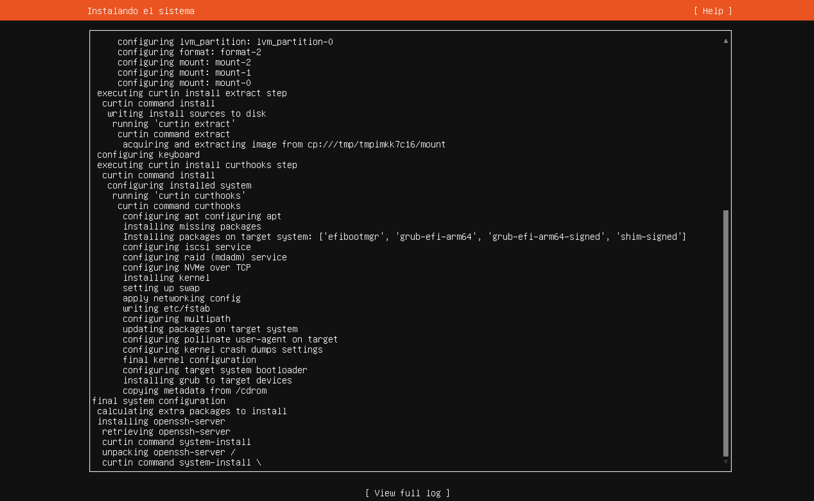
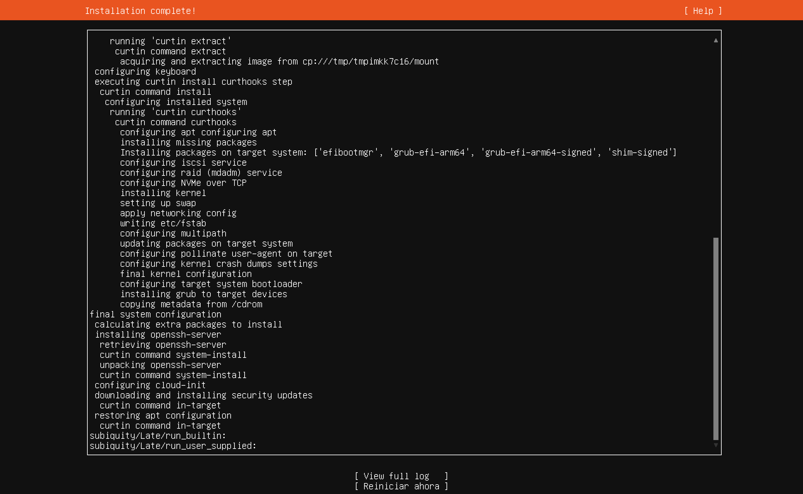

# Paso 13: Instalación y reinicio

> Paso 13 de 13 · [← Snaps destacados](12-snaps.md) · Siguiente: [Primer inicio de sesión](../02-primeros-pasos/01-primer-inicio.md)

El instalador muestra un registro de todo lo que está haciendo. **No toques nada**: según
la velocidad de Internet tarda entre 5 y 15 minutos. Lo que más tarda es la última
parte, *"downloading and installing security updates"*.

## Cómo leer el registro

Cada línea corresponde a una decisión que tomaste en los pasos anteriores:

| Línea del registro | Qué está haciendo | Paso |
|---|---|---|
| `configuring lvm_partition / format / mount` | Crea las particiones y el LVM, les da formato y las monta | 7-8 |
| `acquiring and extracting image` | Copia el sistema base del ISO al disco | — |
| `configuring keyboard` | Aplica la distribución de teclado | 2 |
| `grub-efi-arm64`, `shim-signed` | Instala el **cargador de arranque** UEFI (en un equipo Intel/AMD diría `grub-efi-amd64`) | — |
| `installing kernel` | Instala el núcleo de Linux | — |
| `setting up swap` | Crea el área de intercambio (*swap*) | — |
| `writing etc/fstab` | Escribe el archivo que indica qué partición montar en cada carpeta al arrancar | 8 |
| `installing openssh-server` | Instala el servidor SSH | 11 |
| `downloading and installing security updates` | Descarga los parches publicados después de que salió el ISO | 6 |

El **cargador de arranque** (GRUB) es justo lo que faltaba cuando se usaba el ISO de la
arquitectura equivocada: el firmware ARM no encontraba uno compatible y por eso no
arrancaba (ver [Antes de empezar](README.md#antes-de-empezar-qué-iso-descargo)).

La **swap** es espacio del disco que el sistema usa como RAM de emergencia cuando la RAM
real se llena. Con la analogía del escritorio de la
[Sesión 1](../../00-fundamentos-computo/01-hardware.md): cuando la superficie del
escritorio (RAM) ya no alcanza, se apartan papeles al archivero (disco). Funciona, pero
mucho más lento.

## Instalación completa

Cuando termina, el título cambia a **"Installation complete!"** y aparece abajo
**[ Reiniciar ahora ]**. Selecciónalo con Tab y presiona **Enter**.

Antes de reiniciar aparece el mensaje:

Pide retirar el "disco" de instalación para que el equipo no vuelva a arrancar desde el
ISO. VirtualBox normalmente lo expulsa solo, así que basta con presionar **Enter**. Si al
reiniciar vuelve a aparecer el instalador, apaga la VM, quita el ISO en
**Configuración → Almacenamiento** y arranca de nuevo.
