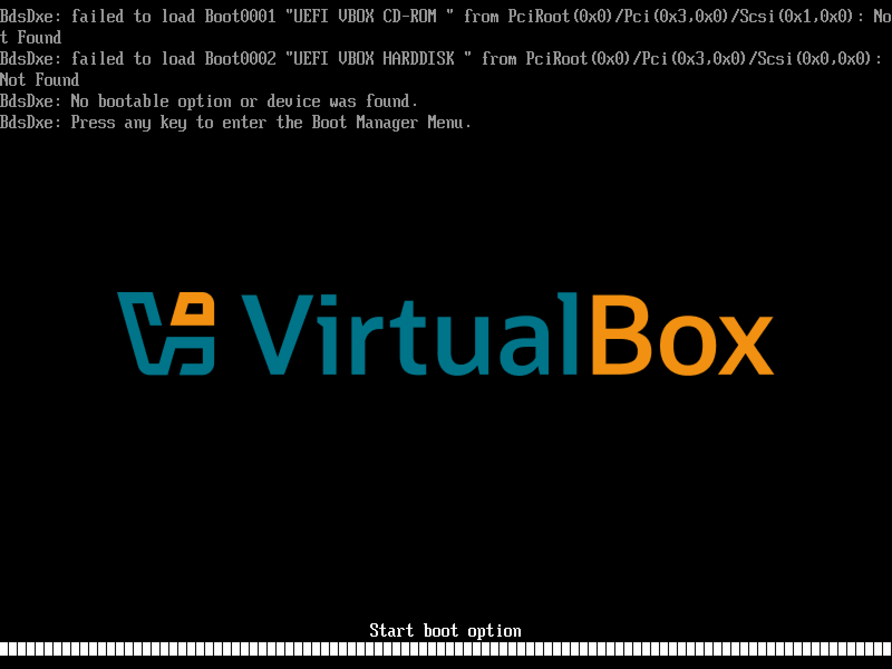
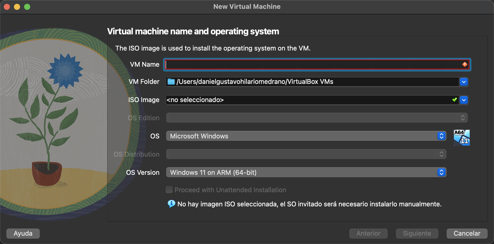

# Instalación de Ubuntu Server

> Guía paso a paso · [← Correo electrónico](../../etapa-2-servicios-red/07-correo.md) ·
> Primer paso: [Idioma](01-idioma.md)

## Por qué Ubuntu Server y no Windows Server

El manual oficial de esta etapa describe la instalación de Windows Server 2003/2008, dos
versiones que llevan años sin soporte. En este curso instalamos en su lugar **Ubuntu
Server 26.04 LTS**: es gratuito, es el sistema que ya usamos en la VM desde
[Máquinas virtuales y Linux](../../00-fundamentos-computo/07-vm-y-linux.md), y en él
corren todas las herramientas que se mencionaron en la Etapa 1 y la Etapa 2 (BIND, Kea,
nginx, Postfix, OpenSSH...).

**LTS** (*Long Term Support*) significa que Canonical, la empresa detrás de Ubuntu, le da
5 años de actualizaciones de seguridad estándar; la versión 26.04 salió en abril de 2026
y tiene soporte estándar hasta mayo de 2031 (Canonical, s.f.-a).

Las ideas de planificación que el manual sí plantea siguen vigentes, sin importar el
sistema operativo: decidir antes de instalar **cuánto disco, cuánta RAM, cómo se
particiona, qué nombre lleva el equipo y qué servicios va a ofrecer**. Cada paso de esta
guía es una de esas decisiones.

## Antes de empezar: ¿qué ISO descargo?

El error más común es descargar la imagen equivocada para el procesador. Una VM simula
el disco, la RAM y la red, pero **no el procesador**: el sistema invitado corre directo
sobre el CPU real, así que tiene que estar compilado para esa arquitectura.

```
Tu computadora                         ISO que necesitas
──────────────────────────────         ──────────────────────────────────
Windows/Linux con Intel o AMD    -->   ubuntu-26.04-live-server-amd64.iso
Mac con Intel (antes de 2020)    -->   ubuntu-26.04-live-server-amd64.iso
Mac con Apple Silicon (M1-M4)    -->   ubuntu-26.04-live-server-arm64.iso
Windows con Snapdragon (ARM)     -->   ubuntu-26.04-live-server-arm64.iso
```

En Windows lo revisas en **Configuración → Sistema → Acerca de → Tipo de sistema**:
"procesador basado en x64" es amd64; "procesador basado en ARM" es arm64.

VirtualBox lo dice explícitamente en su manual: en un equipo ARM, la VM debe usar un
sistema invitado ARM; un invitado x86 no está soportado (Oracle, 2026). Si se usa el ISO
equivocado, la VM no arranca y muestra este error del firmware UEFI:



*"No bootable option or device was found"*: el firmware ARM buscó en el CD un cargador
de arranque ARM y solo encontró uno para x86.

## Crear la VM en VirtualBox

En VirtualBox: **Nueva**. Esta es la primera ventana del asistente:



| Campo | Valor |
|---|---|
| VM Name | `ubuntu-server` (o el que prefieras) |
| ISO Image | El `.iso` que descargaste (amd64 o arm64, según tu equipo) |
| OS / OS Version | Al elegir el ISO, VirtualBox detecta **Linux / Ubuntu**. Si no, elígelo a mano |
| Proceed with Unattended Installation | **Desmarcado**: queremos ver cada pantalla del instalador |

Hardware y disco:

| Recurso | Valor recomendado | Mínimo de Ubuntu Server |
|---|---|---|
| Memoria | 2048-4096 MB | 2 GB |
| CPUs | 2 | — |
| Disco | 25 GB, VDI, reservado dinámicamente | 5 GB |

Los mínimos son los que indica la documentación oficial de Ubuntu Server (Canonical,
s.f.-b). Con 25 GB sobra espacio para los servicios de la Etapa 2.

**Red:** deja el adaptador en **NAT** durante la instalación (da Internet a la VM a
través de tu equipo). Más adelante, para que otros equipos de la red lleguen a la VM
por SSH, se cambia a **adaptador puente** sin reinstalar nada — los modos de red se
explican en [Máquinas virtuales y Linux](../../00-fundamentos-computo/07-vm-y-linux.md).

Con la VM creada, presiona **Iniciar**. Arranca desde el ISO y aparece el instalador.

## Cómo se maneja el instalador

El instalador de Ubuntu Server (se llama **Subiquity**) es de **texto**: no usa el mouse.

| Tecla | Qué hace |
|---|---|
| Flechas ▲ ▼ | Moverse entre opciones de una lista |
| Tab / Shift+Tab | Saltar al siguiente / anterior campo o botón |
| Espacio | Marcar o desmarcar una casilla `[ ]` / `( )` |
| Enter | Activar el botón o la opción resaltada |

Algunas pantallas salen en inglés aunque hayas elegido Español: el instalador no está
traducido por completo. Es normal y no afecta el sistema instalado.

## Los pasos

1. [Idioma](01-idioma.md)
2. [Teclado](02-teclado.md)
3. [Tipo de instalación](03-tipo-de-instalacion.md)
4. [Red](04-red.md)
5. [Proxy](05-proxy.md)
6. [Mirror (réplica de paquetes)](06-mirror.md)
7. [Almacenamiento](07-almacenamiento.md)
8. [Resumen de particiones y confirmación](08-resumen-particiones.md)
9. [Perfil: usuario y nombre del servidor](09-perfil.md)
10. [Ubuntu Pro](10-ubuntu-pro.md)
11. [SSH](11-ssh.md)
12. [Snaps destacados](12-snaps.md)
13. [Instalación y reinicio](13-instalacion.md)
14. [Primer inicio de sesión](14-primer-inicio.md)

## Referencias

Canonical Ltd. (s.f.-a). *Ubuntu release cycle*. https://ubuntu.com/about/release-cycle

Canonical Ltd. (s.f.-b). *Basic installation* [Ubuntu Server documentation].
https://ubuntu.com/server/docs/tutorial/basic-installation/

Oracle. (2026). *Oracle VirtualBox user guide for release 7.2* (G17187-04).
https://docs.oracle.com/en/virtualization/virtualbox/7.2/user/EN-VBOX-7-2-USER.pdf
