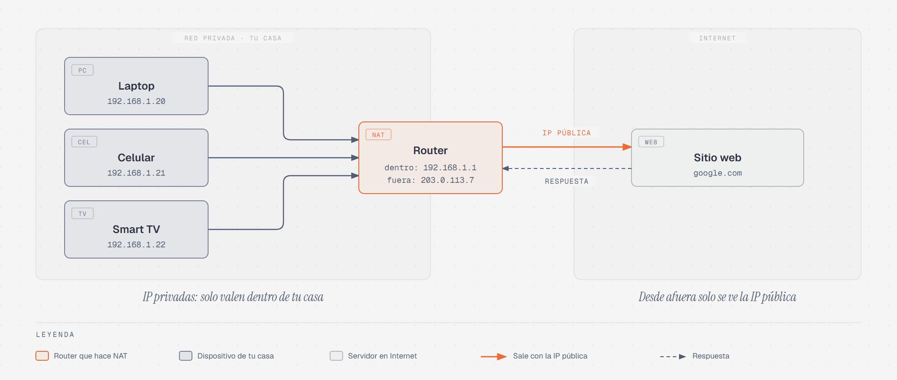
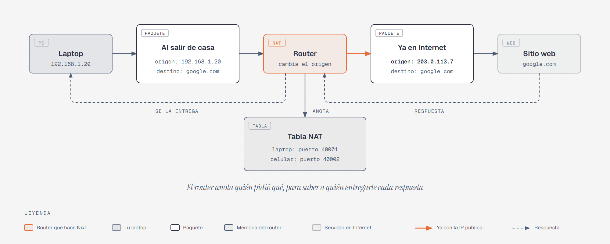

# NAT: muchos equipos, una sola dirección pública

> Acceso remoto 2 · ≈20 min · [← Instalar Git Bash](01-git-bash.md) ·
> Siguiente: [Conectarte a tu servidor por SSH](03-conectarte-por-ssh.md)

## Antes de empezar

Desde la instalación, tu VM tiene la dirección `10.0.2.15` y la red en modo **NAT**. Con
ella pudiste descargar actualizaciones e instalar paquetes sin problema. Pero en la
siguiente práctica vas a intentar algo distinto: **entrar a la VM desde tu
computadora**. Y con NAT, eso no se puede.

Para entender por qué, primero hay que entender qué es NAT. No es algo exclusivo de
VirtualBox: es lo mismo que hace el router de tu casa todos los días, y es una de las
razones por las que Internet sigue funcionando.

## 1. El problema: no alcanzan las direcciones

Cada equipo conectado a una red necesita una **dirección IP**, como cada casa necesita
un número para que le llegue el correo. Las direcciones **IPv4** (las de la forma
`192.168.1.20` que conoces de Redes y Telecomunicaciones) tienen 32 bits, así que solo
existen 2³² de ellas: unos **4,300 millones** (Postel, 1981).

Parecen muchas, pero hoy hay muchos más dispositivos conectados que eso: laptops,
celulares, televisiones, consolas, cámaras... Si cada uno necesitara su propia dirección
única en todo el mundo, hace años que se habrían acabado.

La solución fue separar las direcciones en dos tipos.

## 2. Direcciones privadas y dirección pública

Se reservaron tres rangos de direcciones como **privadas** (Rekhter et al., 1996):

| Rango privado | Dónde lo has visto |
|---|---|
| `10.0.0.0` a `10.255.255.255` | La red NAT de VirtualBox (`10.0.2.15`) |
| `172.16.0.0` a `172.31.255.255` | Redes de algunas empresas y escuelas |
| `192.168.0.0` a `192.168.255.255` | Casi todas las redes de casa |

Una dirección **privada** solo vale **dentro de su propia red**. Por eso tu laptop puede
tener `192.168.1.20` y la laptop de tu vecino también: son redes distintas, y esas
direcciones nunca salen a Internet. Es como el número de un departamento: "depto. 3"
existe en miles de edificios, y no hay problema, porque solo tiene sentido dentro de
cada edificio.

La dirección **pública**, en cambio, es única en todo Internet. Tu proveedor de
Internet le da **una sola** al router de tu casa. Y aquí aparece el problema: si todos
tus equipos tienen direcciones privadas, ¿cómo navegan en Internet con una sola
dirección pública?



En el diagrama, `203.0.113.7` es un ejemplo de dirección pública: ese rango está
reservado para usarse en documentación y ejemplos, así que no pertenece a nadie (Arkko
et al., 2010).

## 3. Qué hace el router: traducir

**NAT** (*Network Address Translation*, "traducción de direcciones de red") es lo que
hace el router para resolver eso: **cambia la dirección privada de cada paquete por su
dirección pública** antes de enviarlo a Internet (Srisuresh & Egevang, 2001).

Recuerda que todo lo que viaja por la red va en **paquetes**, y cada paquete lleva
escritas dos direcciones, como un sobre de carta: **de quién viene** (origen) y **a
quién va** (destino).



Paso a paso, cuando tu laptop abre una página web:

1. La laptop manda un paquete con **origen** `192.168.1.20` (su dirección privada) y
   **destino** el sitio web.
2. El paquete llega al router. El router **tacha el origen** y escribe en su lugar su
   dirección pública, `203.0.113.7`.
3. Antes de enviarlo, el router **anota** en una lista, la **tabla NAT**, que ese
   paquete era de la laptop.
4. El sitio web recibe el paquete. Para él, quien pregunta es `203.0.113.7`: **nunca ve
   la dirección privada** de tu laptop. Responde a esa dirección pública.
5. La respuesta llega al router. El router busca en su tabla NAT a quién le
   corresponde, cambia el destino por `192.168.1.20` y se la entrega a tu laptop.

¿Y si la laptop y el celular navegan al mismo tiempo? Los dos salen con la misma
dirección pública. Para no confundirlos, el router también le asigna a cada conexión un
**puerto** distinto, un número que funciona como "número de turno": la respuesta que
llegue al puerto `40001` es de la laptop, y la que llegue al `40002` es del celular. A
esta forma de NAT, que usa puertos, se le llama **NAPT** (Srisuresh & Egevang, 2001), y
es la que usan los routers de casa.

## 4. Por qué desde afuera nadie puede entrar

La tabla NAT se llena **solo cuando alguien de adentro inicia una conexión**. Eso tiene
una consecuencia muy importante:

- **De adentro hacia afuera, todo funciona.** Tu laptop pide algo, el router lo anota,
  y la respuesta regresa.
- **De afuera hacia adentro, no.** Si un equipo de Internet manda un paquete a
  `203.0.113.7` sin que nadie de adentro lo haya pedido, el router busca en su tabla y
  no encuentra a quién entregárselo. **El paquete se descarta.**

Por eso, desde afuera, todos los equipos de tu casa están "escondidos" detrás del
router. Esto protege a tu red, aunque NAT no fue diseñado como medida de seguridad: es
un efecto secundario de cómo funciona.

Existe una forma de abrir la puerta a propósito, llamada **reenvío de puertos**
(*port forwarding*): se le dice al router "lo que llegue al puerto X, entrégaselo a tal
equipo". En este curso no lo vamos a usar, pero es bueno que sepas que existe.

## 5. VirtualBox también hace NAT

Cuando tu VM está en modo **NAT**, VirtualBox hace exactamente lo mismo que el router de
tu casa, pero **dentro de tu computadora**: crea una red privada solo para la VM, le da
la dirección `10.0.2.15` y traduce sus paquetes para que salgan con la dirección de tu
laptop (Oracle, s.f.).


Ahora ya se entiende el problema del lado izquierdo del diagrama:

- La VM puede salir a Internet: ella inicia las conexiones y el NAT de VirtualBox las
  anota. Por eso `apt update` siempre funcionó.
- Tu laptop **no puede entrar** a la VM: para la laptop, la VM está "del otro lado" del
  NAT, y `10.0.2.15` es una dirección privada de una red que solo existe dentro de
  VirtualBox. Si intentas `ssh` a esa dirección, la conexión nunca llega.

La solución, del lado derecho, es el modo **puente**: la VM deja de estar detrás del NAT
de VirtualBox y se conecta directo a la red real. El router de tu casa le da su propia
dirección privada, igual que a tu laptop, y como las dos quedan **en la misma red**, se
pueden conectar sin traducción de por medio. Eso es lo que vas a configurar en la
siguiente práctica.

## Resumen

- Las direcciones **IPv4** no alcanzan para todos los dispositivos del mundo.
- Las direcciones **privadas** (`10.x`, `172.16.x` a `172.31.x`, `192.168.x`) solo
  valen dentro de su red y se repiten en millones de casas.
- La dirección **pública** es única en Internet; el router de tu casa tiene una.
- **NAT** es el router cambiando la dirección privada de cada paquete por la pública, y
  anotando el cambio en la **tabla NAT** para devolver las respuestas.
- Las conexiones que **salen** funcionan; las que intentan **entrar** se descartan,
  porque no están en la tabla.
- VirtualBox en modo NAT hace lo mismo con tu VM: por eso tu laptop no puede entrar a
  ella, y por eso vas a cambiar al modo **puente**.

## Pruébalo en tu VM

Vas a comprobar con tus propios ojos que tu laptop y tu VM tienen direcciones privadas
distintas, pero **salen a Internet con la misma dirección pública**. Tu VM todavía debe
estar en modo NAT: no cambies nada de la red antes de terminar esta parte.

### En tu VM

Enciende tu VM, inicia sesión en la ventana de VirtualBox y escribe:

```bash
hostname -I
```

`hostname -I` (con **I mayúscula**) muestra solo las direcciones IP del servidor, sin
todo el detalle de `ip a`. La primera debe ser `10.0.2.15`: la dirección privada que le
dio el NAT de VirtualBox.

Ahora pregúntale a un sitio de Internet **con qué dirección te ve llegar**:

```bash
curl -4 ifconfig.me
```

`curl` es un programa que descarga una página web y muestra su contenido en la
terminal, y el sitio `ifconfig.me` responde solo con la dirección desde la que le
llegó la petición. La opción `-4` pide usar IPv4. Aparece una dirección que **no** es
`10.0.2.15`: es la **dirección pública** de la red donde estás. El prompt puede quedar
pegado al final de la dirección, porque la respuesta no termina en un salto de línea.

> 📸 **Captura `NombreApellido-NatVm.png`:** la salida de `hostname -I` y de
> `curl -4 ifconfig.me` en tu VM.

### En tu computadora

Abre **Git Bash** y escribe el mismo comando:

```bash
curl -4 ifconfig.me
```

**Sale la misma dirección pública que en la VM.** Tu VM sale a Internet detrás del NAT
de VirtualBox, tu laptop sale detrás del NAT del router, y al final todos aparecen con
la dirección pública del router. Si estás en tu casa, la de un compañero será distinta,
porque cada casa tiene su propio router; en el laboratorio de la escuela, en cambio, a
todos les saldría la misma. **No compartas tu dirección pública en el chat del grupo**:
identifica la conexión de tu casa.

Para terminar, mira la dirección privada de tu laptop:

```bash
ipconfig
```

`ipconfig` es el comando de **Windows** que viste en Redes y Telecomunicaciones; en Git
Bash también funciona. Busca la línea **Dirección IPv4** (o *IPv4 Address*) de tu
adaptador Wi-Fi o Ethernet: es una dirección privada, casi siempre `192.168.x.x`, y es
distinta de la de la VM y de la pública. Si los acentos se ven raros en Git Bash, es
normal: Windows y Git Bash usan codificaciones distintas para los caracteres.

Tienes tres direcciones distintas para el mismo trabajo:

| Dirección | De quién | Tipo |
|---|---|---|
| `10.0.2.15` | Tu VM | Privada, de la red NAT de VirtualBox |
| `192.168.x.x` | Tu laptop | Privada, de la red de tu casa o escuela |
| La de `ifconfig.me` | El router | Pública: con la que todos salen a Internet |

## Referencias

Arkko, J., Cotton, M., & Vegoda, L. (2010). *IPv4 address blocks reserved for
documentation* (RFC 5737). IETF. https://www.rfc-editor.org/rfc/rfc5737

Oracle. (s.f.). *Virtual networking* [Oracle VirtualBox user guide].
https://www.virtualbox.org/manual/topics/networkingdetails.html

Postel, J. (Ed.). (1981). *Internet protocol* (RFC 791). IETF.
https://www.rfc-editor.org/rfc/rfc791

Rekhter, Y., Moskowitz, B., Karrenberg, D., de Groot, G. J., & Lear, E. (1996).
*Address allocation for private internets* (RFC 1918). IETF.
https://www.rfc-editor.org/rfc/rfc1918

Srisuresh, P., & Egevang, K. (2001). *Traditional IP network address translator
(Traditional NAT)* (RFC 3022). IETF. https://www.rfc-editor.org/rfc/rfc3022
