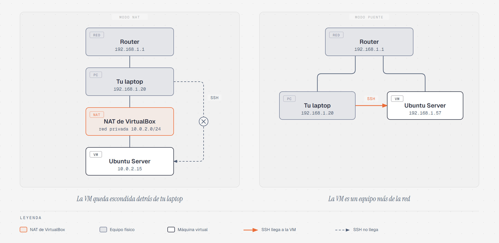

# Conectarte a tu servidor por SSH

> Acceso remoto 3 · ≈30 min · [← NAT: muchos equipos, una sola dirección pública](02-que-es-nat.md) ·
> Siguiente: [Tu primer servicio: un servidor web](04-servidor-web.md)

## Qué vas a hacer

1. Vas a cambiar la red de tu VM para que **tu computadora pueda verla**.
2. Vas a averiguar la **dirección IP** de tu servidor.
3. Vas a **conectarte por SSH** desde Git Bash y trabajar en tu servidor sin tocar la
   ventana de VirtualBox.

Necesitas Git Bash instalado ([Instalar Git Bash](01-git-bash.md)) y tu VM apagada
para empezar.

## Por qué hay que cambiar la red

Como viste en la lectura de [NAT](02-que-es-nat.md#5-virtualbox-también-hace-nat), en
modo NAT tu VM queda escondida detrás del NAT de VirtualBox: puede salir a Internet,
pero tu computadora no puede entrar a ella. Si intentaras `ssh` hacia `10.0.2.15`, la
conexión nunca llegaría.

El modo **Adaptador puente** (*bridged*) conecta la VM **directo a la red real**, como
si fuera otra computadora enchufada al mismo router (Oracle, s.f.). El router le da su
propia IP por **DHCP**, igual que a tu laptop o a tu celular, y como las dos quedan en
la misma red, se pueden conectar.



Las direcciones del diagrama son un ejemplo: las tuyas dependen de tu red.

## Paso 1: Cambiar el adaptador a puente

1. Si tu VM está encendida, apágala: en su ventana, **Máquina → Apagado ACPI**.
2. En la ventana principal de VirtualBox, selecciona tu VM y haz clic en
   **Configuración** (el engrane).
3. Ve a **Red → Adaptador 1**.
4. En **Conectado a**, cambia `NAT` por **Adaptador puente**.
5. En **Nombre**, elige la tarjeta con la que **tu computadora** tiene Internet:
   - Si estás conectado por **Wi-Fi**, la que tiene *Wi-Fi*, *Wireless* o *802.11* en
     el nombre.
   - Si estás conectado por **cable**, la que tiene *Ethernet* o *GbE* en el nombre.
6. Presiona **Aceptar**.

> 📸 **Captura `NombreApellido-AdaptadorPuente.png`:** la ventana de **Configuración →
> Red** con *Adaptador puente* seleccionado. Es una ventana de VirtualBox, no de la VM:
> tómala con **Windows + Shift + S** (en Mac, **Cmd + Shift + 4**).

No hace falta reinstalar nada: Ubuntu ya configuró esa tarjeta para pedir su IP por
DHCP durante la [instalación](../01-instalacion-ubuntu-server/04-red.md). Lo único que
cambia es **a quién** se la pide: antes a VirtualBox, ahora al router de tu red.

## Paso 2: Encontrar la IP de tu servidor

1. Enciende la VM (**Iniciar**) e inicia sesión **en la ventana de VirtualBox**, como
   siempre. Es la última vez en esta práctica que escribes ahí.
2. Escribe el comando que ya conoces del
   [primer inicio de sesión](../02-primeros-pasos/01-primer-inicio.md#la-dirección-ip):

```bash
ip a
```

Busca la tarjeta que empieza con `en` (por ejemplo `enp0s3`) y, debajo, la línea que
empieza con `inet`. Ya **no** debe decir `10.0.2.15`, sino una dirección de tu red,
por ejemplo:

```
inet 192.168.1.57/24 ... dynamic enp0s3
     └─────┬────┘
     esta es la IP de tu servidor
```

**Anota esa IP** (solo los números antes de la `/`): la vas a usar en todos los pasos
siguientes. En esta guía aparece como `192.168.1.57`; **cámbiala siempre por la tuya**.

> 📸 **Captura `NombreApellido-IpPuente.png`:** la salida de `ip a` con la nueva IP.
> Esta sí es de la VM: **Ver → Tomar captura de pantalla...** en VirtualBox.

**Si sigue diciendo `10.0.2.15`**, la VM todavía tiene la dirección vieja. Reiníciala:

```bash
sudo reboot
```

**Si no aparece ninguna línea `inet`**, o aparece una que empieza con `169.254`, la red
no le dio IP a tu VM. Revisa en el Paso 1 que elegiste la tarjeta correcta. Algunas
redes de escuelas, de oficinas o de Wi-Fi públicas no permiten este modo; si es tu
caso, avisa a tu profesor.

**La IP puede cambiar**: si mañana te conectas desde otra red, o el router reparte las
direcciones de nuevo, tu servidor puede tener otra. Antes de conectarte, revísala
siempre con `ip a`.

## Paso 3: Comprobar que tu computadora ve al servidor

Ahora cambia de ventana. Abre **Git Bash** en tu computadora y escribe (con **tu** IP):

```bash
ping -c 3 192.168.1.57
```

Es el mismo `ping` que usaste para comprobar Internet desde el servidor, pero al revés:
ahora **tu computadora** le pregunta al servidor si está ahí. Deben aparecer tres
respuestas y al final **`0% packet loss`**. Si en cambio dice `100% packet loss` o
`Destination host unreachable`, tu computadora no llega a la VM: revisa el Paso 1 y la
IP del Paso 2.

## Paso 4: Conectarte por SSH

En Git Bash escribe `ssh`, **tu usuario del servidor** (el que creaste en el
[Paso 9](../01-instalacion-ubuntu-server/09-perfil.md) de la instalación), una `@` y la
IP de tu servidor:

```bash
ssh usuario@192.168.1.57
```

```
ssh  usuario  @  192.168.1.57
 │      │     │        │
 │      │     │        a qué servidor (su IP)
 │      │     "en"
 │      con qué cuenta del servidor
 el programa
```

### La primera vez: "¿confías en este servidor?"

La **primera vez** que te conectas a un servidor, `ssh` no lo conoce y te pregunta si
confías en él. Aparece algo como:

```
The authenticity of host '192.168.1.57 (192.168.1.57)' can't be established.
ED25519 key fingerprint is SHA256:k3Xf...
This key is not known by any other names.
Are you sure you want to continue connecting (yes/no/[fingerprint])?
```

Cada servidor SSH tiene una **llave** que lo identifica, como una huella digital
(*fingerprint*). `ssh` te muestra la huella del servidor y te pregunta si es el que
esperas. Escribe **`yes`** completo (no basta con `y`) y presiona Enter.

Aparece un aviso de que el servidor se agregó a la lista de servidores conocidos
(`known hosts`). `ssh` guarda esa huella en el archivo `~/.ssh/known_hosts` de **tu
computadora** (OpenBSD, s.f.), y desde la siguiente conexión ya no vuelve a preguntar:
la compara solo. Si algún día la huella no coincide, `ssh` se niega a conectarse y te
avisa, porque podría tratarse de otro equipo haciéndose pasar por tu servidor. Es una
medida de **administración de seguridad**, la S de FCAPS de la
[Etapa 1](../../etapa-1-funciones-administracion/05-administracion-seguridad.md).

### La contraseña

Después te pide la contraseña:

```
usuario@192.168.1.57's password:
```

Es la contraseña **de tu usuario en el servidor**, no la de Windows. Igual que en la
VM, **no se ve nada mientras la escribes**. Escríbela y presiona Enter.

Si entraste, aparecen los mensajes de bienvenida de Ubuntu y, al final, un prompt que
ya conoces:

```
usuario@admredes:~$
```

**Mira bien: estás en la ventana de Git Bash, pero el prompt es el de tu servidor.**
Todo lo que escribas a partir de ahora se ejecuta **en el servidor**, aunque lo
escribas desde tu computadora.

## Paso 5: Trabajar en el servidor desde tu computadora

Comprueba en dónde estás:

```bash
hostname
whoami
ls
```

- `hostname` dice `admredes`: el nombre de **tu servidor**, no el de tu computadora.
- `whoami` dice tu usuario **del servidor**.
- `ls` muestra la carpeta `practica` que creaste en la
  [práctica de archivos](../02-primeros-pasos/06-practica-archivos.md): son tus
  archivos, en tu servidor.

> 📸 **Captura `NombreApellido-ConexionSsh.png`:** la ventana de **Git Bash** con el
> prompt `usuario@admredes` y la salida de `hostname`, `whoami` y `ls`. Tómala con
> **Windows + Shift + S**.

Ahora mira la ventana de VirtualBox: no cambió nada. Las dos son formas de entrar al
**mismo servidor**: la ventana de VirtualBox es como estar sentado frente a él, y SSH
es entrar por la red. Desde ahora puedes **minimizar la ventana de VirtualBox** y
trabajar solo en Git Bash. La VM tiene que seguir **encendida**: si la apagas, no hay
servidor al cual conectarse.

## Paso 6: Salir

Para cerrar la conexión escribe:

```bash
exit
```

Aparece `Connection to 192.168.1.57 closed.` ("conexión cerrada") y el prompt vuelve a
ser el de tu computadora, con `MINGW64`. El servidor sigue encendido: solo cerraste tu
conexión. Para volver a entrar, repite `ssh usuario@192.168.1.57` (esta vez ya no te
pregunta por la huella).

## Si algo sale mal

| Mensaje | Qué significa | Qué hacer |
|---|---|---|
| `Connection timed out` | Tu computadora no encuentra la IP | Revisa que la VM esté encendida, en modo puente, y que la IP sea la de `ip a` |
| `Connection refused` | Llegaste al servidor, pero nadie atiende en el puerto de SSH | En la VM, revisa `systemctl status ssh.socket`, como en el [primer inicio](../02-primeros-pasos/01-primer-inicio.md#el-servicio-ssh) |
| `Permission denied, please try again.` | Usuario o contraseña incorrectos | Revisa que uses tu usuario **del servidor** y su contraseña |
| `REMOTE HOST IDENTIFICATION HAS CHANGED!` | La huella guardada para esa IP no coincide | Pasa si reinstalaste la VM o si la IP ahora es de otro equipo. Pregúntale a tu profesor antes de seguir |

## Comandos que usaste

```
ip a                    (en la VM) ver la IP del servidor
ping -c 3 <IP>          (en tu computadora) comprobar que ves al servidor
ssh <usuario>@<IP>      (en tu computadora) conectarte al servidor
hostname                nombre del equipo en el que estás
exit                    cerrar la conexión SSH
```

**No regreses tu VM a modo NAT**: en la siguiente práctica vas a seguir entrando por
SSH. La lista completa de capturas de acceso remoto está al final de
[Tu primer servicio: un servidor web](04-servidor-web.md#revisa-tus-capturas).

## Referencias

OpenBSD. (s.f.). *ssh(1): OpenSSH remote login client* [Manual page].
https://man.openbsd.org/ssh

Oracle. (s.f.). *Virtual networking* [Oracle VirtualBox user guide].
https://www.virtualbox.org/manual/topics/networkingdetails.html
