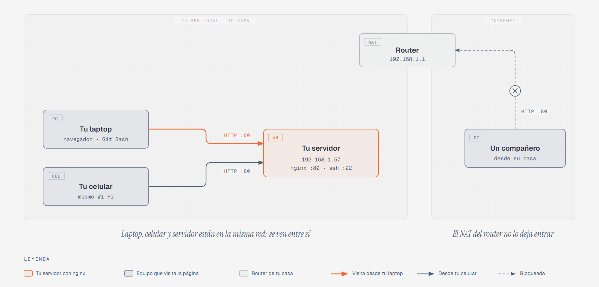

# Tu primer servicio: un servidor web con nginx

> Acceso remoto 4 · ≈50 min · [← Conectarte a tu servidor por SSH](03-conectarte-por-ssh.md)

## Qué vas a hacer

Hasta ahora tu servidor solo ha tenido un servicio: **SSH**, para que tú entres a
administrarlo. Un servidor existe para **dar servicios a otros equipos**, así que en
esta práctica vas a instalar el primero de verdad: un **servidor web**.

1. Vas a instalar **nginx** y comprobar que está funcionando.
2. Vas a abrir la página de tu servidor **desde el navegador de tu computadora** y
   **desde tu celular**.
3. Vas a cambiar esa página por **una tuya**.
4. Vas a ver **en vivo** el registro de cada visita que recibe tu servidor.

**nginx** (se pronuncia "en-yin-ex") es uno de los servidores web más usados del mundo
(F5, s.f.-a). Es el mismo tipo de programa que viste en la lectura de
[WWW](../../etapa-2-servicios-red/04-www.md) de la Etapa 2: recibe peticiones **HTTP**
en el **puerto 80** y responde con páginas web.

## Antes de empezar

- Tu VM debe estar **encendida y en modo puente**, como la dejaste en la
  [práctica anterior](03-conectarte-por-ssh.md).
- Abre **Git Bash** y **conéctate por SSH** a tu servidor (`ssh usuario@IP`). Todos los
  comandos de esta práctica se escriben **en esa sesión SSH**, salvo donde se indique
  otra cosa.
- Ten a la mano la **IP de tu servidor**. Si no la recuerdas, escribe `hostname -I` en
  la sesión SSH. En esta guía aparece como `192.168.1.57`; **cámbiala siempre por la
  tuya**.

## Paso 1: Instalar nginx

```bash
sudo apt update
sudo apt install nginx
```

Son los mismos comandos que usaste para instalar `tree` en
[El administrador, sudo y los paquetes](../02-primeros-pasos/03-administrador-y-paquetes.md):
primero se actualiza la lista de paquetes y después se instala. Cuando pregunte si
deseas continuar, presiona **Enter**.

Al terminar, nginx **ya está funcionando**: en Ubuntu, el servicio arranca solo al
instalarse y también cada vez que se enciende el servidor (Canonical, s.f.).

## Paso 2: Comprobar que está funcionando

Revisa el estado del servicio, igual que revisaste el de SSH en el
[primer inicio](../02-primeros-pasos/01-primer-inicio.md#el-servicio-ssh):

```bash
systemctl status nginx
```

La línea `Active` debe decir **`active (running)`** ("activo, corriendo"). Sal con la
tecla **`q`**.

Ahora comprueba que está **escuchando en el puerto 80**:

```bash
ss -tln
```

`ss` (de *socket statistics*, "estadísticas de conexiones") muestra los puertos en los
que el servidor está esperando conexiones (Kerrisk, s.f.). Las opciones significan:
`-t` solo TCP, `-l` solo los que están escuchando (*listening*) y `-n` mostrar números
en lugar de nombres. En la columna `Local Address:Port` busca estas dos líneas:

| Lo que aparece | Qué servicio es |
|---|---|
| `0.0.0.0:80` | **nginx**, esperando visitas web (HTTP, puerto 80) |
| `0.0.0.0:22` | **SSH**, por donde estás conectado ahora mismo |

`0.0.0.0` significa "en todas las tarjetas de red del servidor": acepta conexiones
venga de donde venga.

## Paso 3: Abrir tu página desde tu computadora

En **tu computadora** (no en Git Bash), abre el navegador y escribe en la barra de
direcciones la IP de tu servidor, empezando con `http://`:

```
http://192.168.1.57
```

Debe aparecer una página que dice **"Welcome to nginx!"**: es la página de prueba que
nginx trae de fábrica. **Tu navegador le pidió una página a tu servidor, y tu servidor
se la envió.** Es exactamente lo que pasa cada vez que abres cualquier sitio web, solo
que ahora el servidor es tuyo.

El navegador probablemente marque la página como **"No seguro"**. Es normal: tu
servidor usa HTTP, sin cifrado. Cómo se protege una página con HTTPS lo viste en la
lectura de [HTTPS](../../etapa-2-servicios-red/05-https.md).

> 📸 **Captura `NombreApellido-NginxNavegador.png`:** el navegador con la página
> "Welcome to nginx!" y la IP de tu servidor en la barra de direcciones. Tómala con
> **Windows + Shift + S**.

## Paso 4: Abrirla desde tu celular

Tu servidor no le da servicio solo a tu computadora, sino a **cualquier equipo de tu
red**. Compruébalo:

1. Conecta tu celular **a la misma red Wi-Fi** que tu computadora.
2. Abre el navegador del celular y escribe la misma dirección: `http://192.168.1.57`.

Debe aparecer la misma página. **Con datos móviles no funciona**: el celular estaría
fuera de tu red, del otro lado del router, y como viste en la lectura de
[NAT](02-que-es-nat.md#4-por-qué-desde-afuera-nadie-puede-entrar), desde afuera nadie
puede entrar. Por la misma razón, un compañero que está en su casa **no puede** abrir
tu página, ni tú la suya.



Tu servidor web es **local**: da servicio a los equipos de tu red. Para que cualquiera
en Internet pudiera verlo habría que abrir un puerto en el router (el *reenvío de
puertos* de la lectura de NAT), y eso no lo haremos con un servidor de práctica.

## Paso 5: Poner tu propia página

nginx busca las páginas que va a enviar en la carpeta `/var/www/html`. Mira qué hay
ahí:

```bash
ls -l /var/www/html
```

Aparece un solo archivo, `index.nginx-debian.html`: es la página "Welcome to nginx!".
Fíjate en sus permisos: el dueño es **`root`**, así que para crear archivos en esa
carpeta necesitas `sudo` (lo viste en
[Archivos, carpetas y permisos](../02-primeros-pasos/05-archivos-y-permisos.md)).

Crea tu propia página con `nano`:

```bash
sudo nano /var/www/html/index.html
```

Escribe este contenido, **cambiando `NombreApellido` por tu nombre**:

```html
<!DOCTYPE html>
<html>
<head>
  <meta charset="utf-8">
  <title>Servidor de NombreApellido</title>
</head>
<body>
  <h1>Hola, soy NombreApellido</h1>
  <p>Esta página la envía mi servidor Ubuntu con nginx.</p>
</body>
</html>
```

Es **HTML**, el lenguaje en el que se escriben las páginas web: `<title>` es el texto
de la pestaña del navegador, `<h1>` un título y `<p>` un párrafo. Guarda con
**Ctrl + O** y Enter, y sal con **Ctrl + X**.

Regresa al navegador de tu computadora y **recarga la página** (tecla **F5**). Ahora
aparece **tu** página. nginx no necesitó reiniciarse: cada vez que alguien pide la
página, la lee del disco en ese momento.

¿Por qué ganó tu archivo y no el de nginx? Cuando alguien pide la página principal,
nginx revisa una lista de nombres de archivo, en orden, y envía el primero que exista
(F5, s.f.-b). En la configuración que trae Ubuntu, esa lista empieza con `index.html` y
termina con `index.nginx-debian.html`. Antes solo existía el último; ahora existe el
primero.

> 📸 **Captura `NombreApellido-MiPagina.png`:** el navegador mostrando tu página, con
> tu nombre. Tómala con **Windows + Shift + S**.

## Paso 6: Ver las visitas en vivo

Cada vez que alguien abre una página, nginx lo anota en un **registro** (*log*): un
archivo de texto con una línea por visita, en `/var/log/nginx/access.log`. Para verlo
en vivo, escribe en la sesión SSH:

```bash
sudo tail -f /var/log/nginx/access.log
```

`tail` muestra el final de un archivo, y la opción `-f` (de *follow*, "seguir") hace
que **se quede esperando** y muestre cada línea nueva en cuanto aparece (Free Software
Foundation, s.f.). La terminal no regresa al prompt: está "escuchando".

Ahora, **sin cerrar Git Bash**:

1. Recarga la página en el navegador de tu computadora (F5). **Aparece una línea nueva**
   en Git Bash.
2. Recárgala desde tu celular. Aparece otra línea, **con otra IP**: la de tu celular.

Cada línea se ve más o menos así (en una sola línea, aquí se partió para que quepa):

```
192.168.1.20 - - [16/Oct/2026:19:05:12 -0600] "GET / HTTP/1.1" 200 215
"-" "Mozilla/5.0 (Windows NT 10.0; Win64; x64) ... Chrome/141.0 Safari/537.36"
```

nginx usa el formato de registro llamado *combined* (F5, s.f.-c). Cada parte significa:

| Parte | Ejemplo | Qué es |
|---|---|---|
| IP del visitante | `192.168.1.20` | **Quién** pidió la página: tu laptop o tu celular |
| Fecha y hora | `[16/Oct/2026:19:05:12 -0600]` | **Cuándo** la pidió |
| Petición | `"GET / HTTP/1.1"` | **Qué** pidió: `GET` es "dame", y `/` es la página principal |
| Código de respuesta | `200` | **Cómo le fue**: `200` significa "todo bien" |
| Tamaño | `215` | Cuántos bytes envió el servidor |
| Navegador | `"Mozilla/5.0 (Windows NT 10.0 ..."` | **Con qué** la pidió: sistema operativo y navegador |

Compara la línea de tu laptop con la de tu celular: en la del celular aparece `Android`
o `iPhone`.

> 📸 **Captura `NombreApellido-RegistroVisitas.png`:** Git Bash con `tail -f` mostrando
> al menos una visita de tu computadora y una de tu celular. Tómala con
> **Windows + Shift + S**.

Este registro es la **administración de contabilidad**, la A de FCAPS de la
[Etapa 1](../../etapa-1-funciones-administracion/04-administracion-contabilidad.md):
quién usó el servicio, cuándo y desde dónde.

**Deja `tail -f` corriendo** para los dos pasos siguientes.

## Paso 7: Provocar un error

En el navegador de tu computadora, pide una página que **no existe**:

```
http://192.168.1.57/no-existe
```

El navegador muestra **"404 Not Found"** ("no encontrado"), y en Git Bash aparece una
línea con `"GET /no-existe HTTP/1.1" 404`. El **código de respuesta** es la forma en que
el servidor dice cómo le fue con cada petición (Fielding et al., 2022):

| Código | Significa | Cuándo lo ves |
|---|---|---|
| `200` | OK, todo bien | La página existe y se envió |
| `404` | No encontrado | La página pedida no existe |

Un administrador que ve muchos `404` en su registro sabe que algo anda mal: un enlace
roto, una página que se borró o alguien probando direcciones al azar. Es la
**administración de fallas**, la F de FCAPS de la
[Etapa 1](../../etapa-1-funciones-administracion/03-administracion-fallas.md).

## Paso 8: Visitas desde la terminal

El navegador no es la única forma de pedir una página. Abre **una segunda ventana de
Git Bash** (la primera sigue con `tail -f`) y, **sin conectarte por SSH**, escribe:

```bash
curl http://192.168.1.57
```

`curl`, el mismo programa que usaste con `ifconfig.me` en la lectura de NAT, pide la
página y muestra el **HTML** tal cual, sin dibujarlo: es el mismo texto que escribiste
en el Paso 5. En la primera ventana aparece una visita nueva, y en la columna del
navegador dice `curl`.

Ahora pide la página **haciéndote pasar por otro navegador**:

```bash
curl -A "Navegador-Inventado" http://192.168.1.57
```

La opción `-A` (de *agent*) le dice a `curl` qué nombre de navegador enviar. En el
registro aparece **`Navegador-Inventado`**. El dato de "con qué navegador" lo declara
el visitante, y **puede ser falso**: un administrador no debe confiar ciegamente en él.
Es un ejemplo de **administración de seguridad**, la S de FCAPS.

Para terminar, haz cinco visitas seguidas, una por segundo, y mira cómo caen una por
una en la primera ventana:

```bash
for i in 1 2 3 4 5; do curl -s -o /dev/null http://192.168.1.57; sleep 1; done
```

`for ... do ... done` repite lo de en medio cinco veces; `-s -o /dev/null` hace que
`curl` no muestre la página (solo queremos la visita), y `sleep 1` espera un segundo
entre cada una.

Cuando termines, en la primera ventana presiona **Ctrl + C** para detener `tail -f`.
Regresas al prompt de tu servidor.

## Comandos que usaste

```
sudo apt install nginx                  instalar el servidor web
systemctl status nginx                  estado del servicio (sal con q)
ss -tln                                 puertos en los que el servidor escucha
sudo nano /var/www/html/index.html      crear o editar tu página
sudo tail -f /var/log/nginx/access.log  ver las visitas en vivo (Ctrl+C sale)
curl http://<IP>                        pedir una página desde la terminal
curl -A "<nombre>" http://<IP>          pedirla con otro nombre de navegador
```

## Revisa tus capturas

En tu carpeta `capturas-admredes` debes tener estas **8 capturas** de acceso remoto,
cada una con tu nombre en lugar de `NombreApellido`:

| Archivo | Qué debe verse | Dónde se hace |
|---|---|---|
| `NombreApellido-GitBash.png` | Git Bash con `ssh -V` | [Instalar Git Bash](01-git-bash.md#paso-4-comprobar-que-tienes-ssh) |
| `NombreApellido-NatVm.png` | `hostname -I` y `curl -4 ifconfig.me` en la VM | [NAT](02-que-es-nat.md#en-tu-vm) |
| `NombreApellido-AdaptadorPuente.png` | VirtualBox con *Adaptador puente* | [Conectarte por SSH](03-conectarte-por-ssh.md#paso-1-cambiar-el-adaptador-a-puente) |
| `NombreApellido-IpPuente.png` | `ip a` con la nueva IP | [Conectarte por SSH](03-conectarte-por-ssh.md#paso-2-encontrar-la-ip-de-tu-servidor) |
| `NombreApellido-ConexionSsh.png` | Git Bash con el prompt del servidor | [Conectarte por SSH](03-conectarte-por-ssh.md#paso-5-trabajar-en-el-servidor-desde-tu-computadora) |
| `NombreApellido-NginxNavegador.png` | "Welcome to nginx!" en el navegador | [Paso 3](#paso-3-abrir-tu-página-desde-tu-computadora) |
| `NombreApellido-MiPagina.png` | Tu página con tu nombre | [Paso 5](#paso-5-poner-tu-propia-página) |
| `NombreApellido-RegistroVisitas.png` | `tail -f` con visitas de tu computadora y tu celular | [Paso 6](#paso-6-ver-las-visitas-en-vivo) |

**Guárdalas**: tu profesor te indicará cómo entregarlas.

## Referencias

Canonical Ltd. (s.f.). *How to install nginx* [Ubuntu Server documentation].
https://ubuntu.com/server/docs/how-to/web-services/install-nginx/

F5. (s.f.-a). *nginx*. https://nginx.org/

F5. (s.f.-b). *Module ngx_http_index_module* [nginx documentation].
https://nginx.org/en/docs/http/ngx_http_index_module.html

F5. (s.f.-c). *Module ngx_http_log_module* [nginx documentation].
https://nginx.org/en/docs/http/ngx_http_log_module.html

Fielding, R., Nottingham, M., & Reschke, J. (Eds.). (2022). *HTTP semantics*
(RFC 9110). IETF. https://www.rfc-editor.org/rfc/rfc9110

Free Software Foundation. (s.f.). *tail invocation* [GNU Coreutils manual].
https://www.gnu.org/software/coreutils/manual/html_node/tail-invocation.html

Kerrisk, M. (s.f.). *ss(8): Linux manual page*. The Linux man-pages project.
https://man7.org/linux/man-pages/man8/ss.8.html
