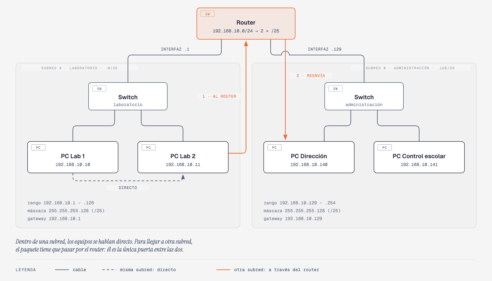

# Subredes

> 50 min · [← La máscara de red](04-mascara-de-red.md) · Siguiente: [Subneteo paso a paso](06-subneteo.md)

## Antes de empezar

Ya sabes calcular, para cualquier IP con su máscara, la dirección de red, el broadcast
y el rango de hosts. Ahora viene la pregunta de un administrador: **si me dan una red,
¿la uso completa o la divido?**

Imagina una escuela con una red `192.168.10.0/24`: 254 direcciones para todo, del
laboratorio de cómputo a la computadora de Dirección. Funciona, pero todos los equipos
quedan "en la misma calle": los alumnos del laboratorio están en la misma red que la
computadora donde se guardan las calificaciones. Esta sesión explica por qué eso es un
problema y cómo se resuelve **dividiendo la red en subredes**. El cálculo completo de
cómo dividirla lo haces en la siguiente sesión.

## 1. Qué es una subred

Una **subred** es un pedazo de una red más grande, que funciona como una red
independiente: tiene su propia dirección de red, su propio broadcast y su propio rango
de hosts (Mogul & Postel, 1985). Al proceso de dividir una red en subredes se le llama
**subneteo** (del inglés *subnetting*).

¿Cuál es la diferencia entre **red** y **subred**? Técnicamente, ninguna: una subred
**es** una red, con todas sus reglas. La palabra "subred" solo dice que salió de
dividir una red más grande. `192.168.10.0/25` es una red como cualquier otra; la
llamamos subred porque la sacamos de `192.168.10.0/24`.

En la analogía del fraccionamiento: subnetear es tomar un fraccionamiento grande y
dividirlo en **secciones cerradas**, cada una con su propia caseta. Dentro de una
sección los vecinos se visitan directo; para ir a otra sección hay que pasar por la
caseta.

## 2. Cómo se hace: pedir prestados bits

En la Sesión 4 viste que la máscara marca la frontera entre red y host. Para hacer
subredes, **se recorre la frontera hacia la derecha**: se toman algunos bits que eran
de **host** y se usan como bits de **red** (Mogul & Postel, 1985). A esto se le llama
**pedir prestados** bits.

Ejemplo: `192.168.10.0/24` dividida en 2, pidiendo prestado **1 bit**:

```
 Red original /24:  11000000.10101000.00001010 . 0 0000000
                    ─────────── red ──────────   ── host ──

 Subredes /25:      11000000.10101000.00001010 . 0 | 0000000   →  .0/25
                    11000000.10101000.00001010 . 1 | 0000000   →  .128/25
                    ─────────── red ──────────   ▲   host
                                                 │
                                  el bit prestado: 0 o 1
```

El bit prestado puede valer `0` o `1`, y cada valor es una subred distinta. Así salen
dos subredes de 128 direcciones cada una:

| Subred | Dirección de red | Rango de hosts | Broadcast | Hosts |
|---|---|---|---|---|
| A | `192.168.10.0/25` | `.1` a `.126` | `192.168.10.127` | 126 |
| B | `192.168.10.128/25` | `.129` a `.254` | `192.168.10.255` | 126 |

Fíjate en el **costo**: antes había 254 hosts; ahora hay 126 + 126 = **252**. Cada
subred nueva gasta dos direcciones más (su propia red y su propio broadcast). Subnetear
siempre cuesta algunas direcciones, y es un precio que vale la pena.

Con más bits prestados pasa exactamente lo mismo, solo que hay más combinaciones. Si de
la misma `192.168.10.0/24` se piden prestados **3 bits**, el prefijo queda en `/27` y
esos 3 bits pueden valer `000`, `001`, `010`… hasta `111`. **Cada combinación es una
subred**:

```
 Último octeto:   prestados | host
                  ──────────┼───────
                    0 0 0   | 00000   →  192.168.10.0/27
                    0 0 1   | 00000   →  192.168.10.32/27
                    0 1 0   | 00000   →  192.168.10.64/27
                    0 1 1   | 00000   →  192.168.10.96/27
                    1 0 0   | 00000   →  192.168.10.128/27
                    1 0 1   | 00000   →  192.168.10.160/27
                    1 1 0   | 00000   →  192.168.10.192/27
                    1 1 1   | 00000   →  192.168.10.224/27
                    ▲ ▲ ▲
                  128 64 32   ← lo que vale cada bit (tabla de la Sesión 3)
```

La parte de host está en ceros porque cada renglón es una **dirección de red**. Para
pasar el renglón a decimal solo se suman los bits prestados que están en 1: `011` es
64 + 32 = **96**. Fíjate también en que las subredes van **de 32 en 32**: 32 es lo que
vale el bit prestado de más a la derecha. Ese número se vuelve el atajo de la siguiente
sesión.

Dentro de cada una de esas 8 subredes, los 5 bits de host funcionan como viste en la
Sesión 4: todos en 0 es la red, todos en 1 es el broadcast, y lo de en medio son los
equipos.

La regla general, que usarás en la siguiente sesión: **con n bits prestados salen 2ⁿ
subredes**, y cada bit prestado **parte a la mitad** el tamaño de cada una.

## 3. Cómo se ve en la red real

Así queda la escuela del ejemplo, con el laboratorio en la subred A y la
administración en la subred B:



Lo importante del diagrama:

- Cada subred tiene **su propio switch** y sus propios equipos.
- El **router** tiene una interfaz en cada subred: `.1` en la A y `.129` en la B. Cada
  una es la **puerta de enlace** de su subred.
- Entre **PC Lab 1** y **PC Lab 2** (misma subred) el paquete va **directo**, por el
  switch.
- De **PC Lab 2** a **PC Dirección** (otra subred) el paquete **tiene que pasar por el
  router**: es la regla de "¿están en la misma red?" de la Sesión 4.

Ese último punto es la clave de todo: **el router es la única puerta entre subredes**,
y en una puerta se pueden poner reglas.

## 4. Para qué sirve dividir una red

### Menos tráfico de broadcast

En la Sesión 2 viste que un **broadcast** les llega a todos los equipos de la red, y
que los routers **no lo dejan pasar**. En una red siempre hay broadcasts: un equipo que
pide DHCP, o uno que pregunta "¿quién tiene la IP `192.168.10.1`?" para averiguar su
dirección MAC (ese protocolo se llama **ARP**; Plummer, 1982). Cada broadcast lo tiene
que recibir y revisar **cada** equipo de la red.

Con 250 equipos en una sola red, todos reciben los broadcasts de todos. Con subredes,
cada broadcast se queda **dentro de su subred**. A la zona hasta donde llega un
broadcast se le llama **dominio de broadcast**: cada subred es uno.

### Más seguridad

Como todo el tráfico entre subredes pasa por el router, ahí se pueden poner reglas:
"el laboratorio **no** puede entrar a la computadora de Dirección", "solo Control
escolar llega al servidor de calificaciones". Si un equipo del laboratorio se infecta
con un virus, el daño queda contenido en su subred. Esta idea de separar la red en
zonas con reglas entre ellas es la misma que la Etapa 1 vio en **administración de
seguridad**.

### Orden y administración

Cada área tiene su rango: si ves la dirección `192.168.10.140`, sabes de inmediato que
es un equipo de administración. Si algo falla, el problema se busca solo en la subred
afectada, sin revisar toda la escuela. Es la **administración de fallas** y de
**configuración** de la Etapa 1, aplicada al direccionamiento.

### Desventajas

Subnetear no es gratis:

- Hace falta un **router** (o un equipo que haga su trabajo) para conectar las
  subredes, y configurarlo.
- Se **pierden direcciones**: dos por cada subred.
- Requiere **planear**: si una subred se queda chica, cambiarla después obliga a
  reconfigurar equipos.
- En una red de casa con cinco dispositivos, normalmente **no hace falta**.

## 5. Planear antes de subnetear

Un buen administrador no subnetea "al tanteo". Antes de calcular, responde dos
preguntas, porque de ellas depende todo el cálculo de la siguiente sesión:

1. **¿Cuántas subredes necesito?** Una por área, por piso, por edificio...
2. **¿Cuántos equipos tendrá la subred más grande?** Y no solo hoy: hay que dejar
   espacio para crecer.

Con esas dos respuestas se arma un **plan de direccionamiento**: una tabla que dice qué
subred le toca a cada área, cuál es su gateway y qué rango reparte su DHCP.

Hay dos formas de dividir:

| Forma | Cómo es | Cuándo |
|---|---|---|
| **Máscara fija** | Todas las subredes del mismo tamaño | Es la base; la que vas a calcular en la siguiente sesión |
| **Máscara variable** (*VLSM*) | Cada subred del tamaño que necesita | Cuando las áreas son de tamaños muy distintos y no quieres desperdiciar direcciones (Pummill & Manning, 1995) |

## Ejemplo resuelto: ¿quién está en qué subred?

La escuela usa las dos subredes `/25` de arriba. ¿En qué subred cae cada equipo y cómo
se comunica con PC Lab 1 (`192.168.10.10`)?

| Equipo | Último octeto | Subred | ¿Cómo llega a PC Lab 1? |
|---|---|---|---|
| `192.168.10.11` | 11 (entre 1 y 126) | A | Directo, misma subred |
| `192.168.10.100` | 100 (entre 1 y 126) | A | Directo |
| `192.168.10.130` | 130 (entre 129 y 254) | B | Por el router |
| `192.168.10.200` | 200 (entre 129 y 254) | B | Por el router |
| `192.168.10.127` | 127 | A, pero es su **broadcast** | No se le puede dar a un equipo |
| `192.168.10.128` | 128 | B, pero es su **dirección de red** | No se le puede dar a un equipo |

## Resumen

- Una **subred** es un pedazo de una red que funciona como red independiente. Al
  proceso se le llama **subneteo**.
- Se hace **pidiendo prestados bits** de host: la frontera de la máscara se recorre a
  la derecha. Con **n** bits salen **2ⁿ** subredes, cada una de la mitad del tamaño por
  cada bit.
- Cada subred pierde dos direcciones (red y broadcast).
- Dentro de una subred los equipos se hablan **directo**; entre subredes, **por el
  router**.
- Sirve para **reducir el broadcast** (cada subred es un dominio de broadcast), poner
  **reglas de seguridad** en el router y **ordenar** la red.
- Antes de calcular se responde: **cuántas subredes** y **cuántos hosts** en la más
  grande.

## Ejercicios

1. Explica con tus palabras la diferencia entre red y subred.
2. Si a una red `/24` le pides prestados 2 bits, ¿cuántas subredes salen? ¿Y con 3?
3. Con las subredes `/25` del ejemplo, ¿en qué subred está `192.168.10.64`? ¿Y
   `192.168.10.250`? ¿Se pueden comunicar directo?
4. ¿Por qué un broadcast del laboratorio no llega a las computadoras de
   administración?
5. Una oficina tiene 6 computadoras y una impresora. ¿Le conviene subnetear? ¿Por qué?

## Soluciones

1. Una subred es una red como cualquier otra, con su dirección de red, broadcast y
   rango de hosts. Se le llama "subred" porque se obtuvo al dividir una red más grande.
2. 2² = 4 subredes con 2 bits; 2³ = 8 con 3 bits.
3. `192.168.10.64` está en la A (de .1 a .126) y `192.168.10.250` en la B (de .129 a
   .254). Están en subredes distintas: no se comunican directo, sino a través del
   router.
4. Porque están en subredes distintas, separadas por el router, y los routers no dejan
   pasar los broadcasts. Cada subred es su propio dominio de broadcast.
5. Normalmente no: son pocos equipos, el tráfico de broadcast es mínimo y se perderían
   direcciones y se complicaría la administración sin ganar casi nada.

## Pruébalo en tu VM

Tu VM ya está en una red, la de tu casa. Vas a ver cómo **ella misma** sabe qué está
en su red y qué no, y después vas a dividir una red con ipcalc.

### Paso 1: la tabla de rutas

```bash
ip route
```

`ip route` muestra la **tabla de rutas**: la lista con la que el sistema decide a
dónde entregar cada paquete (Linux man-pages project, s.f.-a). Verás algo parecido a
esto, con tus propios números (puede haber alguna línea más):

```
default via 192.168.1.1 dev enp0s3 proto dhcp src 192.168.1.50 metric 100
192.168.1.0/24 dev enp0s3 proto kernel scope link src 192.168.1.50 metric 100
```

Las dos líneas importantes son justo la regla de la Sesión 4:

| Línea | Qué significa |
|---|---|
| `192.168.1.0/24 dev enp0s3 ... scope link` | "Todo lo que esté en **mi red** `192.168.1.0/24`, lo entrego **directo** por `enp0s3`." `scope link` significa "está conectado directo a mí" |
| `default via 192.168.1.1 ...` | "Todo lo **demás** (`default`), se lo doy **al router** `192.168.1.1`." Esa es tu **puerta de enlace** |

Compara la dirección de red de la segunda línea con la que te dio
`ipcalc` en la sesión anterior para tu IP: deben ser la misma.

### Paso 2: los vecinos de tu subred

Haz ping a tu puerta de enlace (usa la dirección que salió después de `via`):

```bash
ping -c 3 192.168.1.1
```

Después mira la lista de **vecinos**:

```bash
ip neigh
```

`ip neigh` (de *neighbour*, "vecino") muestra los equipos de **tu misma red** de los
que tu VM ya conoce la dirección MAC, la que averiguó con ARP (Linux man-pages
project, s.f.-b). Debe aparecer tu gateway con su MAC después de `lladdr`. Si entraste
por SSH, aparece también tu laptop. Lo que **nunca** aparece ahí es un equipo de otra
red, como `8.8.8.8`: a esos tu VM nunca les habla directo, solo al router.

### Paso 3: divide una red con ipcalc

ipcalc puede hacer la división por ti si le das **una segunda máscara**, la de las
subredes que quieres (Jodies, s.f.):

```bash
ipcalc 192.168.10.0/24 /25
```

Primero muestra la red original, como en la sesión anterior. Después aparece la línea
`Subnets after transition from /24 to /25` ("subredes después de pasar de /24 a /25")
y la lista de subredes, numeradas `1.` y `2.`, cada una con sus líneas `Network:`,
`HostMin:`, `HostMax:` y `Broadcast:`. Comprueba que coinciden con la tabla de la
sección 2. Al final aparecen `Subnets:` (cuántas subredes salieron, 2) y `Hosts:`
(cuántos hosts suman entre todas, 252).

Ahora pide prestados 2 bits:

```bash
ipcalc 192.168.10.0/24 /26
```

Deben salir **4** subredes, cada una con 62 hosts. Ese es el primer ejemplo de la
siguiente sesión: ya tienes la respuesta para comprobar tu cálculo a mano.

## Referencias

Jodies, K. (s.f.). *ipcalc(1): An IPv4 netmask/broadcast/etc calculator* [Página de
manual del paquete ipcalc 0.51]. https://jodies.de/ipcalc

Linux man-pages project. (s.f.-a). *ip-route(8): Routing table management*.
https://man7.org/linux/man-pages/man8/ip-route.8.html

Linux man-pages project. (s.f.-b). *ip-neighbour(8): Neighbour/ARP tables management*.
https://man7.org/linux/man-pages/man8/ip-neighbour.8.html

Mogul, J., & Postel, J. (1985). *Internet standard subnetting procedure* (RFC 950).
IETF. https://www.rfc-editor.org/rfc/rfc950

Plummer, D. (1982). *An Ethernet address resolution protocol* (RFC 826). IETF.
https://www.rfc-editor.org/rfc/rfc826

Pummill, T., & Manning, B. (1995). *Variable length subnet table for IPv4* (RFC 1878).
IETF. https://www.rfc-editor.org/rfc/rfc1878
