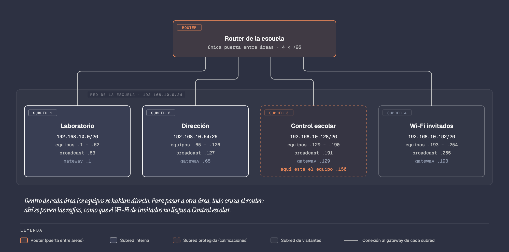

# Evidencia 4: Subnetea una red con tu servidor

De manera **individual**, en tu VM de Ubuntu Server, vas a hacer el **plan de red** de
una escuela: dividir su red en **4 subredes**, una para cada área.

**No vas a hacer ningún cálculo.** Los hace tu servidor con un programa llamado
**ipcalc** (*IP calculator*, "calculadora de IP"). Tu trabajo es **seguir los pasos,
leer lo que te responde y entender por qué sale así**. En cada paso hay una sección
**"¿Por qué?"** que explica el concepto que estás aplicando, con un enlace a la
lectura de la Etapa 4 donde está a fondo. Léela antes de pasar al siguiente paso.

Son **2 capturas** (la captura 1 puede ir en dos partes si la salida no cabe en
una sola pantalla) y **una tabla**.

---

## El problema de la escuela

La escuela ficticia **"Escuela Técnica Las Torres"** tiene **una sola red** para todo:
`192.168.10.0/24`. En ella están conectados, todos juntos:

- las computadoras del **Laboratorio**, que usan los alumnos;
- las de **Dirección**;
- las de **Control escolar**, donde se guardan las **calificaciones**;
- y el **Wi-Fi de invitados**, al que se conecta cualquier visitante con su celular.

Funciona, pero tiene tres problemas serios:

1. **Seguridad.** Un alumno del laboratorio o un visitante del Wi-Fi está **en la
   misma red** que la computadora de las calificaciones. Para la red son "vecinos",
   y nada se interpone entre ellos. Si un celular del Wi-Fi trae un virus, puede
   intentar llegar directo a Control escolar.
2. **Tráfico.** En una red hay mensajes que se envían **a todos los equipos a la
   vez** (se llaman **broadcast**). Con todos en la misma red, cada computadora recibe
   los de todas las demás, aunque no le sirvan para nada.
3. **Orden.** Si algo falla, no hay forma de saber de qué área es un equipo solo con
   ver su dirección: hay que revisar toda la escuela.

**La solución es dividir la red en subredes**, una por área. Cada subred funciona como
una red independiente, y entre ellas queda el **router**, que es la única puerta para
pasar de una a otra. En esa puerta el administrador puede poner reglas, por ejemplo:
"el Wi-Fi de invitados **no** puede entrar a Control escolar". Además, los mensajes a
todos se quedan **dentro de cada área**, y cada área tiene su propio rango de
direcciones: con ver la dirección de un equipo, sabes de qué área es.

Así va a quedar la red de la escuela cuando termines tu plan:



Cada caja es una subred, con su propio rango de direcciones. Las cuatro se conectan
**solo al router**, y cada una por una dirección distinta: su **gateway**. Control
escolar va marcada como **protegida** porque ahí están las calificaciones, y el Wi-Fi
de invitados como **de visitantes**, porque a él se conecta gente de fuera. No te
preocupes todavía por los números: en el paso 3 los vas a ver salir de tu servidor, y
al final vas a poder comparar tu tabla con este diagrama.

> 📖 Esto está explicado a fondo, con un diagrama de dos subredes unidas por un router,
> en la lectura [Subredes](../../contenido/etapa-4-direccionamiento-ip/05-subredes.md),
> secciones 3 y 4.

**Tu trabajo como administrador:** hacer ese plan. Al final vas a tener una tabla que
dice qué subred le toca a cada área y qué direcciones pueden usar sus equipos. Esa
tabla es lo que el administrador le entrega a quien configura el router y los equipos.

---

## Antes de empezar

### ⚠️ Esa red no se configura en ningún lado

`192.168.10.0/24` es la red **en papel** de una escuela que no existe: es un **plan**,
como el plano de una casa antes de construirla. **No tienes que ponerle esa dirección
a tu VM ni a tu computadora, ni cambiar nada de tu red.**

ipcalc es solo una **calculadora**: le das una red y te dice cómo se divide, igual que
una calculadora te da el resultado de una suma sin cambiar nada a tu alrededor. Tu VM
sigue con la misma dirección que le da el router de tu casa, antes y después de la
práctica. En el paso 6 lo vas a comprobar.

Todos los alumnos usan **la misma red**; lo que distingue tu trabajo del de tus
compañeros es **tu usuario**, que se ve en el prompt de cada captura.

### Tu usuario

Tienes dos opciones. Elige **una**:

- **Opción A (recomendada):** usa el usuario que creaste en la **Evidencia 3**, con el
  formato `iniciales-matricula` (por ejemplo `dghm-1410751`). Salta directo al paso 0.
- **Opción B:** si ya no lo tienes o no hiciste la Evidencia 3, crea uno nuevo **con
  tus iniciales**, siguiendo la sección [Crear tu usuario con tus
  iniciales](#crear-tu-usuario-con-tus-iniciales-solo-opción-b), al final de este
  documento. Después regresa al paso 0.

⚠️ **En los comandos aparece `dghm-1410751`. Escribe TU usuario en su lugar.**

### Cómo tomar las capturas

Igual que en la Evidencia 3: **Ver → Tomar captura de pantalla...** en la ventana de la
VM, o **Windows + Shift + S** y selecciona solo la ventana (de la VM o de Git Bash, si
entraste por SSH). Antes de cada captura escribe `clear` para limpiar la pantalla. En
cada captura debe verse el **prompt con tu usuario**.

---

## Paso 0: Entrar con tu usuario

Enciende tu VM e inicia sesión con tu usuario de siempre (el que creaste al instalar
Ubuntu). Después cámbiate a tu usuario de la evidencia:

```bash
su - dghm-1410751
```

```
su   -   dghm-1410751
└┬┘  │   └─────┬────┘
 │   │         tu usuario (opción A o B)
 │   empieza una sesión nueva, en la carpeta de ese usuario
 "substitute user": cambiar de usuario
```

**Qué debes hacer:** escribe la contraseña **de ese usuario**. Mientras la escribes no
aparece nada; es normal.

**Qué debes ver:** el prompt cambia y ahora empieza con tu usuario:
`dghm-1410751@...:~$`.

**¿Por qué?** En un servidor real cada administrador trabaja con **su propia cuenta**,
para que quede registrado quién hizo qué. Aquí, además, tu usuario en el prompt es la
prueba de que las capturas son tuyas.

---

## Paso 1: Descargar la lista de paquetes

```bash
sudo apt update
```

**Qué debes ver:** `sudo` te pide tu contraseña (un asterisco por letra), varias
líneas `Get:` o `Hit:` (o `Obj:` y `Des:` en español) y al final el prompt, **sin
ninguna línea que empiece con `Error:`**.

**¿Por qué?** Antes de instalar cualquier programa, el servidor necesita la **lista
más reciente** de lo que hay en el repositorio de Ubuntu; si no, podría buscar una
versión vieja que ya no existe. `update` solo descarga esa lista, todavía no instala
nada. Lo viste en [El administrador, sudo y los
paquetes](../../contenido/etapa-3-sistema-operativo-red/02-primeros-pasos/03-administrador-y-paquetes.md).

---

## Paso 2: Instalar ipcalc

```bash
sudo apt install -y ipcalc
```

```
sudo   apt   install   -y   ipcalc
                       │    └─┬──┘
                       │      el programa: la calculadora de redes
                       responde "sí" automáticamente
```

**Qué debes ver:** unas líneas de instalación y al final el prompt. Si ya lo tenías
instalado, apt solo avisa que ya está en su versión más reciente; también está bien.

**¿Por qué?** ipcalc hace en un instante los cálculos que un administrador haría con
binario: dirección de red, máscara, primer y último equipo, broadcast. Su propio
manual dice que está pensado también **para aprender**, porque muestra los resultados
de forma fácil de entender (Jodies, s.f.). Lleva `sudo` porque instalar un programa
cambia todo el servidor, y eso solo lo puede hacer un administrador.

---

## Paso 3: Dividir la red en 4 subredes

Antes del comando, entiende **qué le vas a pedir** a ipcalc y por qué.

### Lo que significa `/24`

La red de la escuela es `192.168.10.0/24`. Ese **`/24`** es el **prefijo**: dice que
los primeros **24 bits** de la dirección (los tres primeros números, `192.168.10`) son
la **parte de red**, el "nombre de la calle", y que los **8 bits** que quedan (el último
número) son la **parte de equipo**: los números de casa. Con 8 bits hay 256
direcciones, de `.0` a `.255`.

> 📖 Qué es el prefijo y cómo marca la frontera entre red y equipo:
> [La máscara de red](../../contenido/etapa-4-direccionamiento-ip/04-mascara-de-red.md),
> secciones 1 y 2. Qué es un bit y por qué 8 bits dan 256 combinaciones:
> [El sistema binario](../../contenido/etapa-4-direccionamiento-ip/03-sistema-binario.md),
> secciones 2 y 7.

### Cómo se divide: "pedir prestados" bits

Para hacer subredes, se **recorre la frontera hacia la derecha**: se toman algunos bits
de la parte de equipo y se usan para numerar subredes. A eso se le llama **pedir
prestados** bits.

- Con **1 bit** prestado, ese bit puede valer `0` o `1`: salen **2 subredes**.
- Con **2 bits**, las combinaciones son `00`, `01`, `10` y `11`: salen **4 subredes**.
- Con **3 bits**, salen **8**. Cada bit que pides **duplica** el número de subredes.

El prefijo nuevo es el de siempre **más los bits prestados**: 24 + 2 = **/26**. Esta
tabla junta todo, para que no tengas que calcularlo:

| Subredes que necesitas | Bits prestados | Prefijo que escribes | Equipos por subred |
|---|---|---|---|
| 2 | 1 | `/25` | 126 |
| **4** | **2** | **`/26`** | **62** |
| 8 | 3 | `/27` | 30 |

**¿Por qué cada subred es más chica?** Porque los bits que prestas **se los quitas a
los equipos**. Con `/26` quedan 6 bits para equipos: 64 direcciones por subred. Cada
bit prestado parte el tamaño a la mitad: 256 → 128 → 64 → 32.

**¿Y por qué 62 y no 64?** Porque en cada subred hay **dos direcciones que no se le
pueden dar a ningún equipo**: la **primera**, que es el nombre de la subred
(`Network`), y la **última**, que sirve para hablarle a todos a la vez (`Broadcast`).
64 − 2 = **62**.

**¿Por qué no 3 subredes, si alcanzara con menos?** Porque con bits solo se pueden
formar **potencias de 2**: 2, 4, 8, 16. Si la escuela necesitara 3 áreas, tendría que
usar 4 subredes y dejar una libre para crecer.

> 📖 Pedir prestados bits, con el dibujo de cada combinación:
> [Subredes](../../contenido/etapa-4-direccionamiento-ip/05-subredes.md), sección 2.
> Por qué se restan 2 direcciones (red y broadcast):
> [La máscara de red](../../contenido/etapa-4-direccionamiento-ip/04-mascara-de-red.md),
> secciones 4 y 5.

### El comando

La escuela necesita **4** subredes, así que usas **`/26`**:

```bash
ipcalc -b 192.168.10.0/24 /26
```

```
ipcalc   -b   192.168.10.0/24   /26
└──┬─┘   └┬┘  └───────┬──────┘   └┬┘
   │      │           │           el prefijo de las subredes (de la tabla)
   │      │           la red completa de la escuela
   │      sin binario: solo números normales, para que se lea fácil
   la calculadora
```

Le das **dos cosas**: la red que tienes (`/24`) y el tamaño de las subredes que
quieres (`/26`). ipcalc hace el resto.

**Qué debes ver:**

1. Arriba, los datos de la red completa.
2. La línea `Subnets after transition from /24 to /26` ("subredes después de pasar de
   /24 a /26").
3. Cuatro bloques numerados **`1.`** a **`4.`**: **cada bloque es una subred**. En cada
   uno, estas líneas:

| Línea | Qué significa |
|---|---|
| `Network:` | La dirección de la subred: su "nombre". No se le da a ningún equipo |
| `HostMin:` | La **primera** dirección que se le puede dar a un equipo |
| `HostMax:` | La **última** dirección que se le puede dar a un equipo |
| `Broadcast:` | La dirección para hablarle a **todos** los equipos de esa subred. Tampoco se le da a un equipo |
| `Hosts/Net:` | Cuántos equipos caben: **62** |

4. Al final, **`Subnets: 4`**.

**¿Por qué las subredes van de 64 en 64?** Mira dónde empieza cada una: `.0`, `.64`,
`.128` y `.192`. Cada subred tiene 64 direcciones, así que la siguiente empieza
**justo donde termina la anterior**: si la 1 termina en `.63`, la 2 empieza en `.64`. Y
la última termina en `.255`, igual que la red completa: **las 4 subredes juntas ocupan
toda la red, sin que sobre ni se repita ninguna dirección**. Eso es lo que hace que el
plan sea correcto.

> 📖 Este mismo ejemplo resuelto a mano, paso a paso:
> [Subneteo paso a paso](../../contenido/etapa-4-direccionamiento-ip/06-subneteo.md),
> ejemplo 1. A ese salto de 64 se le llama **tamaño de bloque** (sección 1).

> 📸 **Captura 1:** el prompt con tu usuario y la salida completa, del comando hasta
> `Subnets: 4`. Si no cabe, maximiza la ventana; si aun así no cabe, tómala en dos partes
> (las dos cuentan como la captura 1).

---

## Paso 4: Llenar la tabla de la escuela

Este paso **no es un comando**: **copia** lo que te mostró el paso 3 a esta tabla, en
tu documento de Word. Cada área toma un bloque, en orden:

| Área | Subred (`Network`) | Primer equipo (`HostMin`) | Último equipo (`HostMax`) | Broadcast |
|---|---|---|---|---|
| Laboratorio (bloque 1) | | | | |
| Dirección (bloque 2) | | | | |
| Control escolar (bloque 3) | | | | |
| Wi-Fi invitados (bloque 4) | | | | |

*La primera fila ya llena, para que veas cómo va:* Laboratorio · `192.168.10.0/26` ·
`192.168.10.1` · `192.168.10.62` · `192.168.10.63`.

**¿Por qué?** Esta tabla es el **plan de direccionamiento**: el documento que dice
qué direcciones le tocan a cada área. Con ella, quien configure la red sabe, por
ejemplo, que a las computadoras del laboratorio hay que darles direcciones entre
`.1` y `.62`, y que ninguna de Control escolar puede quedar en ese rango. Por eso
cuenta tanto copiar bien: **un número mal escrito en el plan es un equipo mal
configurado** en la red real.

Por costumbre, la **primera dirección** de cada subred (`HostMin`) se reserva para el
**router**: es la **puerta de enlace** de esa área, la puerta por la que salen sus
paquetes hacia las demás.

> 📖 Qué es la puerta de enlace:
> [La máscara de red](../../contenido/etapa-4-direccionamiento-ip/04-mascara-de-red.md),
> sección 6. Qué preguntas se responden antes de hacer un plan:
> [Subredes](../../contenido/etapa-4-direccionamiento-ip/05-subredes.md), sección 5.

---

## Paso 5: ¿De qué área es este equipo?

En la escuela hay un equipo con la dirección **`192.168.10.150`**. Pregúntale a ipcalc
a qué subred pertenece:

```bash
ipcalc -b 192.168.10.150/26
```

```
ipcalc   -b   192.168.10.150/26
              └──────┬─────┘└┬┘
                     │       con las subredes /26 de la escuela
                     la dirección del equipo
```

**Qué debes ver:** en la línea **`Network:`** aparece **`192.168.10.128/26`**. Búscala
en tu tabla: es el bloque 3, **Control escolar**.

**¿Por qué?** Esta es una pregunta de todos los días para un administrador: "me
reportan una falla en el equipo `.150`, ¿de qué área es?". Las subredes empiezan en
`.0`, `.64`, `.128` y `.192`. El 150 queda **entre 128 y 192**, así que pertenece a la
subred que empieza en `.128`. Gracias al plan, **la dirección sola ya te dice el
área**: ese es el "orden" que se buscaba al principio.

Y más importante: **así decide la red quién es vecino de quién**. Si un equipo del
Laboratorio (por ejemplo `.20`) le quiere mandar algo al `.150`, su computadora ve que
están en **subredes distintas** y le entrega el paquete **al router**, no directo. Ahí,
en el router, es donde se aplican las reglas de seguridad.

> 📖 Cómo decide un equipo si el destino está en su misma red o tiene que pasar por el
> router: [La máscara de red](../../contenido/etapa-4-direccionamiento-ip/04-mascara-de-red.md),
> sección 7. Cómo ubicar una dirección en su subred:
> [Subneteo paso a paso](../../contenido/etapa-4-direccionamiento-ip/06-subneteo.md),
> sección 3.

---

## Paso 6: Comprobar que tu VM no cambió

Ahora comprueba lo que se dijo al principio: ipcalc no le cambió nada a tu servidor.

```bash
hostname -I
```

`hostname -I` (con **I mayúscula**) muestra la dirección IP **real** de tu VM.

**Qué debes ver:** una dirección como `192.168.1.50`: la que le da el router de tu
casa, la misma de siempre. Las direcciones de la escuela solo existen en la respuesta
de ipcalc y en tu tabla. (Si la de tu VM empieza con `192.168.10.`, es solo
coincidencia: algunos routers de casa usan esa red. Tampoco cambió nada.)

**¿Por qué?** Porque **planear una red y configurarla son dos trabajos distintos**.
Primero se hace el plan, como acabas de hacer, y se revisa con calma. Solo después,
con el plan aprobado, se configuran el router y los equipos. Hacerlo al revés, cambiando
direcciones "a ver qué pasa", es la forma más rápida de dejar sin red a toda una
escuela.

Tu VM, por cierto, tiene una dirección **dinámica**: se la presta el servidor DHCP del
router de tu casa.

> 📖 Direcciones estáticas y dinámicas:
> [Tipos de direcciones IP](../../contenido/etapa-4-direccionamiento-ip/02-tipos-de-direcciones.md),
> sección 2.

> 📸 **Captura 2:** el prompt con tu usuario, la salida del paso 5 y la del paso 6.
> (No uses `clear` entre los dos comandos, para que salgan en la misma captura.)

Debajo de la captura, escribe en una línea: *"El equipo 192.168.10.150 pertenece a
Control escolar"*.

**Terminaste.** Hiciste el plan de red de la escuela: 4 subredes, una por área, con su
rango de direcciones, listo para que alguien configure el router con reglas entre
ellas.

---

## Entregable

Un solo **PDF** con, en este orden:

1. Tu nombre, tu matrícula y tu usuario.
2. La **captura 1**.
3. La **tabla** del paso 4, llena.
4. La **captura 2**, con la línea del área.

Arma el documento en Word y guárdalo como PDF: **Archivo → Guardar como → PDF**.

---

## Forma de entrega

- **Modalidad:** Individual.
- **Plataforma:** NEXUS, en la evidencia *"4.3 Evidencia de aprendizaje 4: Servidor Configurado"*.
- **Nombre del archivo:** `EV4_ApellidoNombre.pdf` (ejemplo: `EV4_PerezJuan.pdf`).
- **Fecha de entrega:** sábado 14 de noviembre de 2026.
- **Hora límite:** 10:00 p.m.

---

## Rúbrica de evaluación

| CRITERIO / NIVEL DE DOMINIO | Evidencia Completa | Evidencia Suficiente | Evidencia Débil | Sin evidencia |
|---|---|---|---|---|
| **Conocimientos** — Identifica las necesidades y requerimientos de su contexto para poder aplicar su conocimiento en el ámbito de las TI | **3** — La tabla está completa y coincide con la captura 1, y dice correctamente el área del equipo `.150`. | **2** — La tabla tiene 1 o 2 datos mal copiados, o falta el área del equipo. | **1** — La tabla tiene 3 o más datos mal copiados o está incompleta. | **0** — Sin evidencia. |
| **Habilidades** — Experimenta problemáticas reales en un ambiente simulado para detectar las posibles soluciones y fallas que se pueden presentar | **5** — Están las 2 capturas con **su usuario** en el prompt; la captura 1 muestra `Subnets: 4` y la 2 muestra la subred del equipo y la IP real de su VM. | **4** — Falta una captura, o una no muestra su usuario. | **3** — Faltan las dos capturas, o ninguna muestra su usuario. | **0** — Sin evidencia. |
| **Actitudes / Valores** — Participa y colabora de forma proactiva en la resolución de problemáticas de red computacional | **2** — Se entrega en la fecha y hora indicadas, en un solo PDF con el nombre `EV4_ApellidoNombre.pdf`, en orden y legible. | **1** — Se entrega un día después de la fecha y hora indicadas. | **0** — Se entrega dos días después de la fecha y hora indicadas. | **0** — Sin evidencia. |

*Se respetan los criterios, niveles y puntos de la rúbrica de NEXUS; solo se adaptó el
contenido de cada nivel a esta práctica.*

---

## Crear tu usuario con tus iniciales (solo opción B)

Haz esta sección **solo si no tienes el usuario de la Evidencia 3**. Se hace con tu
usuario de siempre, el que creaste al instalar Ubuntu, que ya es administrador.

Tu usuario nuevo son **tus iniciales**: la primera letra de cada nombre y apellido,
**en minúsculas** y sin acentos (si tienes ñ, usa n). *Ejemplo:* Daniel Gustavo
Hilario Medrano → **`dghm`**. En Ubuntu un nombre de usuario debe empezar con una
letra y no acepta espacios, acentos ni ñ (Debian, s.f.).

⚠️ **En estos pasos aparece `dghm`. Escribe TUS iniciales.**

### Paso B1: Crear el usuario

```bash
sudo adduser dghm
```

```
sudo   adduser   dghm
└┬─┘   └──┬──┘   └┬─┘
 │        │       el nombre de la cuenta nueva (tus iniciales)
 │        "add user": agregar un usuario
 como administrador
```

**Qué debes hacer:** el comando hace varias preguntas, unas en inglés y otras en
español:

1. Si `sudo` te pide tu contraseña de siempre, escríbela.
2. **`New password:`** la contraseña del usuario nuevo. **No aparece nada** mientras
   escribes. Elige una que recuerdes.
3. **`Retype new password:`** escríbela otra vez.
4. **`Nombre completo []:`** tu nombre completo.
5. **`Número de habitación []:`**, **`Teléfono del trabajo []:`**, **`Teléfono de
   casa []:`** y **`Otro []:`**: presiona **Enter** en cada uno.
6. **`Is the information correct? [Y/n]`:** presiona **Enter**.

Si dice que el usuario **ya existe** (por ejemplo, porque tus iniciales coinciden con
otra cuenta), agrégale un número al final: `dghm2`.

### Paso B2: Convertirlo en administrador

```bash
sudo usermod -aG sudo dghm
```

```
sudo   usermod   -aG    sudo   dghm
       └──┬──┘   └┬─┘   └┬─┘   └┬─┘
          │       │      │      a qué usuario
          │       │      al grupo "sudo": los administradores
          │       -a: agregar, -G: a un grupo
          "user modify": modificar un usuario
```

Lo necesita porque en los pasos 1 y 2 de la evidencia vas a usar `sudo` con este
usuario: en Ubuntu, solo los usuarios del grupo `sudo` pueden usarlo (Canonical Ltd.,
s.f.).

**Qué debes ver:** nada. Si regresa el prompt sin mensajes, salió bien.

### Paso B3: Comprobar sus grupos

```bash
groups dghm
```

**Qué debes ver:** una línea como `dghm : dghm sudo users`. Lo importante es que en la
lista aparezca **`sudo`**.

**Listo.** Regresa al [paso 0](#paso-0-entrar-con-tu-usuario) y entra con tu usuario
nuevo: `su - dghm`.

---

## Referencias

Canonical Ltd. (s.f.). *User management* [Ubuntu Server documentation].
https://documentation.ubuntu.com/server/how-to/security/user-management/

Debian. (s.f.). *adduser.conf(5): configuration file for adduser*. Debian Manpages.
https://manpages.debian.org/testing/adduser/adduser.conf.5.en.html

Jodies, K. (s.f.). *ipcalc(1): An IPv4 netmask/broadcast/etc calculator*.
https://jodies.de/ipcalc
